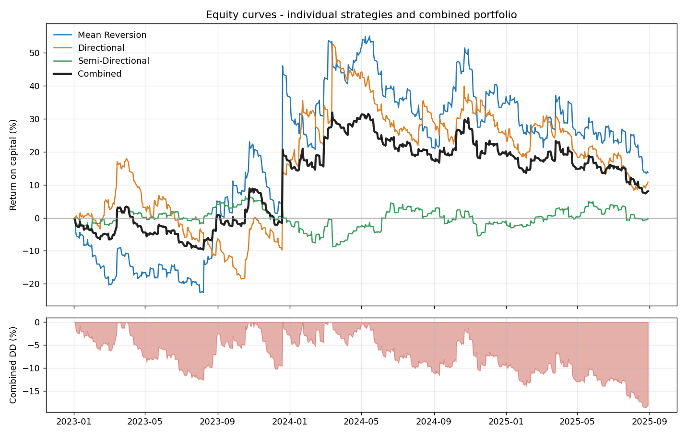

# Holdout test: frozen rules on 2023-01-02 to 2025-08-29

Data: `data/dhan_2023_2025/nifty_opt_1min.parquet` | 654 trading days | Frozen snapshot: `frozen/rules_v1.json` (frozen 2026-10-24 00:35:14, commit c10d7a4, last in-sample date 2026-10-16)

Rules, sizing and costs are taken from the snapshot and were not changed for this run.

## Performance

|  | Mean Reversion | Directional | Semi-Directional | Combined |
|---|---|---|---|---|
| Start | 2023-01-02 | 2023-01-02 | 2023-01-02 | 2023-01-02 |
| End | 2025-08-29 | 2025-08-29 | 2025-08-29 | 2025-08-29 |
| Trading days | 654 | 654 | 654 | 654 |
| Final equity | Rs 11,36,832 | Rs 11,08,446 | Rs 9,96,367 | Rs 32,41,644 |
| Total return | 13.7% | 10.8% | -0.4% | 8.1% |
| CAGR | 4.9% | 4.0% | -0.1% | 3.0% |
| Annual volatility | 36.3% | 28.9% | 11.3% | 20.1% |
| Sharpe | 0.30 | 0.27 | 0.04 | 0.24 |
| Sharpe 95% CI low | -0.82 | -0.88 | -1.17 | -0.89 |
| Sharpe 95% CI high | 1.42 | 1.42 | 1.26 | 1.37 |
| P(true Sharpe > 0) | 69.9% | 67.8% | 52.9% | 66.2% |
| Sortino | 0.77 | 0.74 | 0.05 | 0.64 |
| Max drawdown | -26.9% | -31.0% | -14.9% | -18.6% |
| Longest drawdown (days) | 319 | 359 | 453 | 359 |
| Calmar | 0.18 | 0.13 | -0.01 | 0.16 |
| Worst day | -4.30% | -3.32% | -4.78% | -3.32% |
| Best day | 39.50% | 26.05% | 3.99% | 22.58% |
| Days with a trade | 100% | 100% | 100% | 100% |
| Positive months | 44% | 50% | 47% | 41% |
| Trades | 916 | 654 | 654 | 2224 |
| Win rate | 38.4% | 43.7% | 52.8% | 44.2% |
| Avg P&L / trade | Rs 149 | Rs 166 | Rs -6 | Rs 109 |
| Avg win | Rs 11,517 | Rs 11,846 | Rs 3,683 | Rs 8,863 |
| Avg loss | Rs -6,945 | Rs -8,911 | Rs -4,124 | Rs -6,826 |
| Avg win / avg loss | 1.66 | 1.33 | 0.89 | 1.30 |
| Profit factor | 1.03 | 1.03 | 1.00 | 1.03 |
| Best trade | Rs 1,46,789 | Rs 2,35,131 | Rs 38,406 | Rs 2,35,131 |
| Worst trade | Rs -24,583 | Rs -39,656 | Rs -47,570 | Rs -47,570 |
| Max consecutive losses | 18 | 9 | 7 | 18 |
| Avg holding time | 259 min | 309 min | 171 min | 248 min |
| Gross P&L (after slippage) | Rs 2,16,076 | Rs 1,71,449 | Rs 75,566 | Rs 4,63,092 |
| Charges | Rs 79,244 | Rs 63,003 | Rs 79,200 | Rs 2,21,448 |
| Charges / gross profits | 2% | 2% | 6% | 3% |

## By calendar year

|  | Total return | CAGR | Sharpe | Sharpe 95% CI low | Sharpe 95% CI high | Max drawdown | Calmar | Trades | Win rate |
|---|---|---|---|---|---|---|---|---|---|
| Mean Reversion 2023 | 36.9% | 37.4% | 0.86 | -0.69 | 2.42 | -22.7% | 1.65 | 349 | 40.1% |
| Mean Reversion 2024 | -1.2% | -1.2% | 0.09 | -1.89 | 2.06 | -21.9% | -0.05 | 337 | 37.7% |
| Mean Reversion 2025 | -16.0% | -23.3% | -1.13 | -3.72 | 1.45 | -17.3% | -1.35 | 230 | 37.0% |
| Directional 2023 | 16.3% | 16.5% | 0.61 | -1.11 | 2.33 | -31.0% | 0.53 | 245 | 44.5% |
| Directional 2024 | 8.8% | 8.8% | 0.43 | -1.44 | 2.30 | -20.2% | 0.44 | 245 | 40.8% |
| Directional 2025 | -12.4% | -18.3% | -1.22 | -3.73 | 1.29 | -17.7% | -1.03 | 164 | 47.0% |
| Semi-Directional 2023 | -1.0% | -1.0% | -0.06 | -2.05 | 1.93 | -8.0% | -0.12 | 245 | 47.8% |
| Semi-Directional 2024 | -0.6% | -0.6% | 0.03 | -1.97 | 2.02 | -9.5% | -0.06 | 245 | 54.3% |
| Semi-Directional 2025 | 1.2% | 1.8% | 0.24 | -2.21 | 2.70 | -5.6% | 0.33 | 164 | 57.9% |
| Combined 2023 | 17.4% | 17.6% | 0.73 | -0.83 | 2.30 | -12.6% | 1.40 | 839 | 43.6% |
| Combined 2024 | 2.3% | 2.3% | 0.22 | -1.74 | 2.18 | -11.5% | 0.20 | 827 | 43.5% |
| Combined 2025 | -10.0% | -14.9% | -1.29 | -3.90 | 1.32 | -12.9% | -1.15 | 558 | 46.1% |

## By day type

| strategy / day_type | trades | win rate | avg P&L (Rs) | total P&L (Rs) |
|---|---|---|---|---|
| Directional / DTE 1 | 131 | 41% | 2,190 | 2,86,953 |
| Directional / expiry (DTE 0) | 139 | 72% | -80 | -11,066 |
| Directional / far (2+ days) | 384 | 34% | -436 | -1,67,441 |
| Mean Reversion / DTE 1 | 393 | 41% | 1,429 | 5,61,726 |
| Mean Reversion / expiry (DTE 0) | 139 | 33% | -2,513 | -3,49,289 |
| Mean Reversion / far (2+ days) | 384 | 38% | -197 | -75,605 |
| Semi-Directional / DTE 1 | 131 | 56% | 1,358 | 1,77,939 |
| Semi-Directional / expiry (DTE 0) | 139 | 56% | -910 | -1,26,489 |
| Semi-Directional / far (2+ days) | 384 | 51% | -143 | -55,084 |

| net P&L by day type (Rs) | Directional | Mean Reversion | Semi-Directional | Combined |
|---|---|---|---|---|
| DTE 1 | 2,86,953 | 5,61,726 | 1,77,939 | 10,26,617 |
| expiry (DTE 0) | -11,066 | -3,49,289 | -1,26,489 | -4,86,843 |
| far (2+ days) | -1,67,441 | -75,605 | -55,084 | -2,98,130 |

## Holdout vs in-sample

|  | Mean Reversion | Directional | Semi-Directional | Combined |
|---|---|---|---|---|
| CAGR: in-sample | 52.7% | 33.2% | 26.8% | 37.6% |
| CAGR: holdout | 4.9% | 4.0% | -0.1% | 3.0% |
| Sharpe: in-sample | 1.74 | 1.58 | 2.26 | 2.31 |
| Sharpe: holdout | 0.30 | 0.27 | 0.04 | 0.24 |
| Sharpe 95% CI low: in-sample | 0.08 | -0.14 | 0.40 | 0.71 |
| Sharpe 95% CI low: holdout | -0.82 | -0.88 | -1.17 | -0.89 |
| Sharpe 95% CI high: in-sample | 3.40 | 3.29 | 4.12 | 3.90 |
| Sharpe 95% CI high: holdout | 1.42 | 1.42 | 1.26 | 1.37 |
| Max drawdown: in-sample | -9.9% | -12.8% | -4.4% | -7.3% |
| Max drawdown: holdout | -26.9% | -31.0% | -14.9% | -18.6% |
| Calmar: in-sample | 5.33 | 2.60 | 6.12 | 5.12 |
| Calmar: holdout | 0.18 | 0.13 | -0.01 | 0.16 |
| Win rate: in-sample | 42.2% | 50.4% | 55.4% | 48.5% |
| Win rate: holdout | 38.4% | 43.7% | 52.8% | 44.2% |
| Profit factor: in-sample | 1.45 | 1.37 | 1.68 | 1.46 |
| Profit factor: holdout | 1.03 | 1.03 | 1.00 | 1.03 |

## Correlation of daily returns

|  | Mean Reversion | Directional | Semi-Directional |
|---|---|---|---|
| Mean Reversion | 1.0 | 0.45 | 0.46 |
| Directional | 0.45 | 1.0 | -0.07 |
| Semi-Directional | 0.46 | -0.07 | 1.0 |

## Monthly returns

| Month | Mean Reversion | Directional | Semi-Directional | Combined |
|---|---|---|---|---|
| 2023-01 | -8.2% | +1.2% | -3.3% | -3.4% |
| 2023-02 | -10.5% | +4.2% | +1.3% | -1.4% |
| 2023-03 | +8.5% | +11.8% | +5.3% | +8.6% |
| 2023-04 | -6.5% | -12.5% | -3.0% | -7.6% |
| 2023-05 | +1.3% | +3.1% | +1.0% | +1.8% |
| 2023-06 | -4.9% | -7.6% | -1.5% | -4.7% |
| 2023-07 | -1.0% | -5.7% | -0.2% | -2.4% |
| 2023-08 | +32.2% | +0.0% | +4.8% | +11.2% |
| 2023-09 | +4.4% | -8.4% | -0.8% | -1.3% |
| 2023-10 | +11.2% | +15.7% | +2.6% | +9.5% |
| 2023-11 | -13.5% | -1.9% | -5.3% | -7.4% |
| 2023-12 | +29.7% | +20.7% | -1.2% | +16.6% |
| 2024-01 | -10.6% | +12.6% | -4.8% | -1.3% |
| 2024-02 | +16.6% | +2.3% | +3.2% | +7.6% |
| 2024-03 | +0.9% | +8.4% | -4.7% | +2.1% |
| 2024-04 | +5.0% | -0.8% | +4.9% | +2.8% |
| 2024-05 | -4.9% | -7.8% | -1.7% | -5.2% |
| 2024-06 | -5.8% | -4.5% | +6.1% | -2.3% |
| 2024-07 | -3.4% | -2.8% | +0.6% | -2.1% |
| 2024-08 | -7.1% | +5.0% | -0.0% | -0.9% |
| 2024-09 | +10.5% | -3.7% | -3.1% | +1.4% |
| 2024-10 | +8.2% | +8.9% | +1.4% | +6.6% |
| 2024-11 | -5.1% | -3.6% | -1.9% | -3.7% |
| 2024-12 | -1.8% | -3.2% | +0.2% | -1.8% |
| 2025-01 | -7.2% | -6.2% | -1.1% | -5.2% |
| 2025-02 | -1.1% | +7.3% | +3.2% | +3.1% |
| 2025-03 | +8.9% | +2.4% | +2.3% | +4.7% |
| 2025-04 | -7.5% | -8.5% | -2.3% | -6.4% |
| 2025-05 | +0.2% | +1.3% | +3.1% | +1.4% |
| 2025-06 | +0.7% | -3.3% | +0.3% | -0.8% |
| 2025-07 | -0.6% | -5.7% | -2.8% | -3.0% |
| 2025-08 | -9.3% | +0.5% | -1.3% | -3.7% |

## Exit reasons

| strategy / reason | trades | win rate | avg P&L (Rs) | total P&L (Rs) |
|---|---|---|---|---|
| Directional / square-off | 627 | 46% | 1,228 | 7,70,192 |
| Directional / stop | 27 | 0% | -24,509 | -6,61,746 |
| Mean Reversion / square-off | 711 | 43% | 1,734 | 12,32,877 |
| Mean Reversion / stop | 95 | 0% | -11,812 | -11,22,100 |
| Mean Reversion / time exit | 110 | 42% | 237 | 26,054 |
| Semi-Directional / square-off | 131 | 56% | 1,358 | 1,77,939 |
| Semi-Directional / time exit | 523 | 52% | -347 | -1,81,573 |

## Where the frozen rules ranked in the 2023-2025 search

Rank by t-statistic among the candidates for the same day type in `data/dhan_2023_2025/search/scores.csv`. That search covered this data, so this window is a holdout for the final rules but not data nobody has looked at.

| strategy | day type | rule | rank (by t) | t-stat | search P&L 2024 (Rs) | search P&L 2025 (Rs) |
|---|---|---|---|---|---|---|
| Mean Reversion | far (2+ days) | open fade 10:00 long exit 15:15 stop 0.0 | 31 of 2046 | 0.07 | -18,985 | -67,419 |
| Mean Reversion | DTE 1 | pc fade 10:20 long exit 15:15 stop 1.0 | not in search |  |  |  |
| Mean Reversion | DTE 1 | pc fade 10:35 long exit 15:15 stop 1.0 | not in search |  |  |  |
| Mean Reversion | DTE 1 | pc fade 10:50 long exit 15:15 stop 1.0 | not in search |  |  |  |
| Mean Reversion | expiry (DTE 0) | open fade 10:00 debit6 exit 12:00 stop 1.0 | 1636 of 2046 | -1.84 | -65,177 | -1,41,052 |
| Directional | far (2+ days) | pcr follow 10:00 long exit 15:15 stop 0.0 | 306 of 2046 | -0.92 | 51,657 | -79,738 |
| Directional | DTE 1 | pcr follow 10:15 long exit 15:15 stop 1.0 | 222 of 2046 | 0.67 | 20,146 | -56,488 |
| Directional | expiry (DTE 0) | pcr follow 09:55 credit5 exit 15:15 stop 0.0 | not in search |  |  |  |
| Semi-Directional | far (2+ days) | pc follow 09:30 otmcredit3 exit 12:00 stop 0.0 | 817 of 2046 | -1.78 | -69,655 | 13,132 |
| Semi-Directional | DTE 1 | pc fade 10:30 credit5 exit 15:15 stop 0.0 | 119 of 2046 | 0.92 | 17,346 | 8,707 |
| Semi-Directional | expiry (DTE 0) | open fade 10:00 credit5 exit 12:00 stop 0.0 | 1367 of 2046 | -1.26 | -6,437 | -17,344 |

## Market regime in the window

| period | days | lot size | expiry weekday |
|---|---|---|---|
| 2023Q1 | 62 | 50 | Thu, Wed |
| 2023Q2 | 60 | 50 | Thu, Wed |
| 2023Q3 | 63 | 50 | Thu |
| 2023Q4 | 60 | 50 | Thu |
| 2024Q1 | 60 | 50 | Thu |
| 2024Q2 | 60 | 25 | Thu, Wed |
| 2024Q3 | 64 | 25 | Thu, Wed |
| 2024Q4 | 61 | 25/75 | Thu |
| 2025Q1 | 61 | 75 | Thu |
| 2025Q2 | 61 | 75 | Thu, Wed |
| 2025Q3 | 42 | 75 | Thu, Tue |

## Skipped days
0 days with fewer than 300 one-minute bars: none
