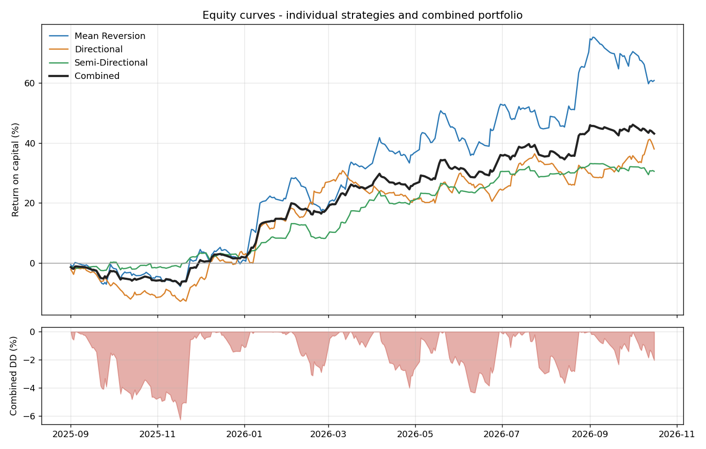
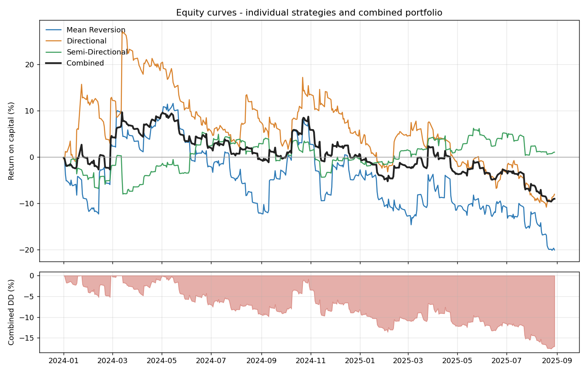

# NIFTY Intraday Options: Three-Strategy Backtest Report


## Summary

Three rule-based intraday NIFTY option strategies were designed and fitted on 1 Sep 2025 – 16 Oct 2026. Over that
year they turned ₹30 lakh into ₹42.93 lakh (+43.1%, Sharpe 2.31, max drawdown -7.3%). The rules were then frozen and
run, unchanged, on earlier data. **The edge doesn't carry over:**

| Combined book | Period | Trading days | Return | CAGR | Sharpe | Max drawdown |
| --- | --- | --- | --- | --- | --- | --- |
| In-sample (fitted) | 1 Sep 2025 – 16 Oct 2026 | 278 | +43.1% | +37.6% | 2.31 | -7.3% |
| **Holdout** | **1 Jan 2024 – 29 Aug 2025** | **409** | **-9.0%** | **-5.5%** | **-0.36** | **-17.6%** |
| Holdout extended to 2023 | 2 Jan 2023 – 29 Aug 2025 | 654 | +8.1% | +3.0% | 0.24 | -18.6% |
| Paper trading (preliminary) | 19 – 22 Oct 2026 | 3 | -0.8% | — | — | — |

The 2024–2025 holdout is the most important result in the project. It's the period just before the fitted year, under
almost the same market rules, and the combined book lost money in it, with a drawdown it never recovered from. Adding
2023 turns the total slightly positive, but that comes from a single day (20 Dec 2023, +₹6.67 lakh). Without that day
the 32-month result is about -₹4.25 lakh.

No contract change examined explains the break (see [Is there a structural explanation?](#is-there-a-structural-explanation)).
Lot size makes no material difference, and the months after SEBI's November 2024 reforms were the holdout's worst
stretch. The move to Tuesday expiry can't be tested on history, because it began on the first day of the fitted year.
The in-sample profit is concentrated in January–October 2026: within that, 10 trading days produced 78.2% of the
profit on the day before expiry.

**What held up.** One rule was profitable in every period tested: Semi-Directional's DTE 1 credit spread (a 250-point
ATM credit spread sold at 10:30 on the day before expiry, held to 15:15).

| Semi-Directional DTE 1 credit spread | Trades | Win rate | Net P&L |
| --- | --- | --- | --- |
| In-sample, Sep 2025 – Oct 2026 | 53 | 60% | +₹1,30,016 |
| Holdout, Jan 2024 – Aug 2025 | 79 | 59% | +₹1,11,567 |
| Holdout extended, Jan 2023 – Aug 2025 | 131 | 56% | +₹1,77,939 |

It was picked out after seeing every period, so this is a lead to test on new data, not a confirmed edge.

**Costs decide the result.** The base case assumes slippage of max(0.25 points, 0.5% of premium) per fill. The
near-expiry spreads have legs priced around 40–100 points, so a fixed points floor hurts most. Raising the floor to 2
points per fill cuts the in-sample DTE 1 + expiry-day profit from ₹11,78,798 to ₹3,62,943 (-69.2%). The DTE 1 credit
spread stays profitable at a 1-point floor in both periods (in-sample ₹76,919, holdout ₹47,779). At 2 points it makes
₹9,090 in-sample and loses ₹22,877 in the holdout. The data has no bid-ask quotes, so the real fill cost is not known.

**What the project shows.** A strategy picked on one year can look strong (Sharpe 2.31) and still fail on the period
just before it. Freezing the rules before testing, testing each contract change separately, and pricing in realistic
costs is what exposed this. The in-sample results describe the year the rules were selected on, not a lasting edge.
Paper trading of the frozen rules continues; its results are kept in a separate, preliminary section below.

## Theory and hypotheses

The core hypothesis is that NIFTY's intraday behaviour changes with the weekly expiry cycle. If so, a rule that fits
the day's position in the cycle should beat one rule applied every day. Each strategy therefore has one rule for each
of three day types: 2+ days to expiry ("far"), the day before expiry (DTE 1), and expiry day (DTE 0).

| Strategy | Market view | Signal | Hypothesis it tests |
| --- | --- | --- | --- |
| Mean Reversion | The morning move overshoots and partly reverses | Spot vs the day's open (far, expiry) or previous close (DTE 1); trade against it | Early moves come from overnight order flow and gap-filling, and fade by midday or the close |
| Directional | Positioning tells you where the day goes | Put/call open-interest ratio over ATM±5 strikes; PCR ≥ 1 = bullish; trade with it | Option writers' positioning near the money carries information about the day's direction |
| Semi-Directional | Time decay pays if you are roughly right on direction | Spot vs previous close or open; sell a defined-risk credit spread | Short premium with a directional tilt earns theta, especially near expiry, and loses little when wrong |

Supporting design choices:

- **Gamma and theta peak near expiry.** The strategies take more risk on DTE 1 and expiry days (risk multipliers up
  to 3×) and less on far days (0.5×).
- **Defined risk only.** Every position is a long option or a vertical spread, so the worst-case loss is known at
  entry and drives sizing.
- **Intraday only.** Everything is flat by 15:15.

## Strategy rules and how they were chosen

Each strategy trades every day, with one rule per day type: nine rules in all, and Mean Reversion's DTE 1 rule
enters three times. The signal is read on the close of the bar before the entry time and filled at the next bar's
open.

| Strategy | Day type | Signal | Entry | Structure | Exit | Stop | Risk × |
| --- | --- | --- | --- | --- | --- | --- | --- |
| Mean Reversion | Far | Fade spot vs open | 10:00 | Long ATM option | 15:15 | None | 0.5 |
| Mean Reversion | DTE 1 | Fade spot vs previous close | 10:20, 10:35, 10:50 | Long ATM option | 15:15 | 1.0× range | 1.0 each |
| Mean Reversion | Expiry | Fade spot vs open | 10:00 | Debit spread, 300 pts wide | 12:00 | 1.0× range | 1.0 |
| Directional | Far | Follow PCR | 10:00 | Long ATM option | 15:15 | None | 1.0 |
| Directional | DTE 1 | Follow PCR | 10:15 | Long ATM option | 15:15 | 1.0× range | 2.0 |
| Directional | Expiry | Follow PCR | 09:55 | ATM credit spread, 250 pts wide | 15:15 | None | 0.5 |
| Semi-Directional | Far | Follow spot vs previous close | 09:30 | OTM credit spread (short 100 pts OTM, 150 wide) | 12:00 | None | 0.5 |
| Semi-Directional | DTE 1 | Fade spot vs previous close | 10:30 | ATM credit spread, 250 pts wide | 15:15 | None | 3.0 |
| Semi-Directional | Expiry | Fade spot vs open | 10:00 | ATM credit spread, 250 pts wide | 12:00 | None | 3.0 |

The stop applies only to debit trades. A "1.0× range" stop sits one morning-range width beyond the far edge of the
range set before entry.

**How the rules were chosen, and what that means.** The candidates for each strategy and day type combined a
reference and mode, signal and exit times, a structure, a stop width and a risk multiplier. The acceptance test was
that every strategy be profitable in both halves of the fitted year (split 1 Apr 2026), with a combined Calmar of at
least 5. Before that, an earlier search on 2023–2025 tried 6,138 single-rule candidates
(`experiments/variant_log.csv`). The refit on the fitted year added an unrecorded number on top. With that many
candidates, a Sharpe of 2.3 on one year is well within what selection alone can produce.

The rules were frozen to `frozen/rules_v1.json` (commit c10d7a4) before any of the out-of-sample tests below were
run. Every test loads that snapshot, and the code is checked against it each time.

## Position sizing

Lots are set so that a position's worst-case loss is a fixed share of the sleeve's current equity: 2% × the rule's
risk multiplier. Each strategy runs its own ₹10 lakh sleeve, and equity compounds.

```latex
\text{lots} = \min\left(20,\ \left\lfloor \frac{2\% \times \text{risk multiplier} \times \text{equity}}{\text{worst-case loss per unit} \times \text{lot size}} \right\rfloor\right)
```

- **Worst-case loss** is the premium paid for a long option or debit spread, or the spread width minus the credit
  for a credit spread, plus slippage on both fills.
- **Caps:** at most 20 lots. For debit trades, the premium outlay is also capped at 20% of equity.
- **One-lot floor:** if the formula gives 0, the trade still takes 1 lot, but only if one lot's worst case is under
  5% of equity.
- **Lot size** comes from NSE for each date: 50 (2023), 25 (Apr–Nov 2024), 75 (Nov 2024 – Dec 2025), 65 (from
  Dec 2025).

The multipliers put nearly all the risk on the last two days of the expiry week. On far days, Mean Reversion and
Semi-Directional almost always trade the 1-lot floor.

## In-sample results (fitted period, 1 Sep 2025 – 16 Oct 2026)



| Strategy | Final equity (from ₹10L) | CAGR | Sharpe (95% CI) | Max drawdown | Calmar | Profit factor |
| --- | --- | --- | --- | --- | --- | --- |
| Mean Reversion | ₹16.08L | 52.7% | 1.74 (0.08 – 3.40) | -9.9% | 5.33 | 1.45 |
| Directional | ₹13.80L | 33.2% | 1.58 (-0.14 – 3.29) | -12.8% | 2.60 | 1.37 |
| Semi-Directional | ₹13.05L | 26.8% | 2.26 (0.40 – 4.12) | -4.4% | 6.12 | 1.68 |
| **Combined** | **₹42.93L** | **37.6%** | **2.31 (0.71 – 3.90)** | **-7.3%** | **5.12** | **1.46** |

**Profit by day type (₹, net of costs)**

| Day type | Mean Reversion | Directional | Semi-Directional | Combined | Share |
| --- | --- | --- | --- | --- | --- |
| DTE 1 | 4,18,307 | 2,15,441 | 1,30,016 | 7,63,764 | 59% |
| Expiry | 1,79,354 | 38,148 | 1,97,532 | 4,15,034 | 32% |
| Far | 10,364 | 1,26,020 | -22,197 | 1,14,187 | 9% |

Other in-sample observations:

- Every strategy was weaker in the second half than the first (combined Sharpe 2.74, then 1.81). Being profitable in
  both halves was a selection condition, so this shows stability within the fitted year, not out-of-sample skill.
- None of the 149 robustness and stress variants lost money in-sample. But Mean Reversion's Sharpe peaks sharply at
  its chosen entry times (1.74, against 1.04–1.55 at ±10 minutes), a typical sign of a fitted parameter.
- The book was roughly flat (-0.75%) from 1 Sep to 16 Oct 2026, the last six weeks before the freeze.
- Mean Reversion and Semi-Directional move together (correlation 0.77). Directional is uncorrelated with both, which
  lifts the combined Sharpe above each strategy's own.

Full in-sample detail is in `results/report.md`.

## Out-of-sample: January 2024 – August 2025

This is the main test. The frozen rules ran unchanged on `data/dhan_2023_2025/nifty_opt_1min.parquet`. Where this
file overlaps the in-sample file, prices, open interest, expiries and lot sizes match exactly, so the result isn't a
data artifact. The window ends on 29 Aug 2025, the last trading day before the fitted year starts.

| | Holdout CAGR | Holdout Sharpe | Holdout max DD | In-sample CAGR | In-sample Sharpe | In-sample max DD |
| --- | --- | --- | --- | --- | --- | --- |
| Mean Reversion | -12.6% | -0.44 | -28.5% | 52.7% | 1.74 | -9.9% |
| Directional | -4.9% | -0.10 | -29.9% | 33.2% | 1.58 | -12.8% |
| Semi-Directional | +0.6% | 0.11 | -9.2% | 26.8% | 2.26 | -4.4% |
| **Combined** | **-5.5%** | **-0.36** | **-17.6%** | **37.6%** | **2.31** | **-7.3%** |



- **By year:** roughly flat in 2024 (+0.7%) and -9.6% in Jan–Aug 2025 (Sharpe -1.35).
- **By day type:** DTE 1 made +₹1.34 lakh, expiry day lost ₹2.63 lakh, and far days lost ₹1.42 lakh. Expiry day,
  which was 32% of the in-sample profit, was the biggest loser.
- **Stops:** Mean Reversion's 52 stopped trades lost ₹4.85 lakh, and Directional's 19 lost ₹4.20 lakh.
- **The holdout isn't fully clean.** The earlier 6,138-candidate search covered this data. The final rules weren't
  picked from that search: four of the eleven aren't in it, and most of the rest ranked poorly. But the data had been
  looked at before.

### Extended to January 2023

Running from 2 Jan 2023 gives +8.1% (CAGR 3.0%, Sharpe 0.24, 95% CI -0.89 to 1.37), with a profit factor of 1.03.

| Combined | 2023 | 2024 | Jan–Aug 2025 |
| --- | --- | --- | --- |
| Return | +17.4% | +2.3% | -10.0% |
| Sharpe | 0.73 | 0.22 | -1.29 |

The results get worse year by year, and the year just before the fitted period is the worst. 2023's gain is
dominated by 20 Dec 2023: +₹6.67 lakh across the three strategies, out of ₹2.42 lakh net for the whole 32 months.
Without the five best trades, the period loses ₹6.29 lakh. Mean Reversion's and Semi-Directional's expiry-day rules
lost money in every year, and Directional's (always 1 lot) was roughly flat. Details: `2023-2025 test/ANALYSIS.md`.

## Is there a structural explanation?

The holdout loss could mean the rules were overfitted. It could also mean the market changed in a way the rules
depend on. Three contract changes happened around the fitted period:

| Date | Change |
| --- | --- |
| 20 Nov 2024 | SEBI F&O measures begin (phased): one weekly-expiry index per exchange, higher minimum contract size, extra expiry-day margin. Lot size 25 → 75 for new contracts (first seen in the data on 2 Dec 2024) |
| 1 Sep 2025 | NIFTY weekly expiry moves from Thursday to Tuesday, so DTE 1 moves from Wednesday to Monday |
| 30 Dec 2025 | Lot size 75 → 65 (first seen in the data on 31 Dec 2025) |

The fitted year starts on the same day as the Tuesday expiry. So "overfitted" and "only works with Tuesday expiry"
can't be told apart by comparing the two periods directly. `structural_break.py` checks each change separately (full
results in `structural_break/`):

| Check | Result | Verdict |
| --- | --- | --- |
| Holdout re-run at today's lot size (and at 25, 50, 75) | Combined Sharpe 0.23–0.27 at every lot size (actual: 0.24); in-sample 2.18–2.33 | No material effect |
| Holdout after the SEBI changes (20 Nov 2024 – Aug 2025), the closest market to today apart from the weekday | Total return -9.84%, Sharpe -1.09 (95% CI -3.47 to 1.29); the worst stretch of the test | No support |
| Tuesday expiry: in-sample Sep–Dec 2025 vs Jan–Oct 2026 | Sep–Dec 2025 (83 days): total return +1.95%, Sharpe 0.49 (95% CI -2.84 to 3.83). Jan–Oct 2026 (195 days): +40.36%, Sharpe 3.03 (1.24 to 4.81). Both are inside the fitted year | Most of the return came in 2026; the 83-day sample is too short to compare with the holdout |
| Rule-free: long ATM straddle on DTE 1, 10:20 → 15:15 | Mean +0.43% on 124 holdout Wednesdays, +0.70% on 53 in-sample Mondays (t = -0.19, p = 0.85); days with a gain 33.1% vs 43.4% (p = 0.19) | No significant change in DTE 1 option pricing |
| Monday DTE 1 follows the weekend: bigger gaps to fade? | Avg gap 0.482% (Mondays) vs 0.242% (Wednesdays), but the highest in-sample average came on small-gap days: 10 Mondays in 2026 made ₹5,97,161 (78.2% of DTE 1 profit). No gap bucket is significant at 5% | Profit not concentrated on large-gap days |
| Volatility regime | Best quarter (Q1 2026) had the highest volatility, but similar-volatility quarters in 2024 and 2025 lost money | Not a separating factor |

**Conclusion:** no contract change examined accounts for the gap between the fitted year and the holdout. Lot size has
no material effect, and the post-SEBI market lost the most. The in-sample profit is concentrated in January–October
2026, and within that in a handful of DTE 1 Mondays. The Tuesday-expiry explanation remains untested, because its
whole history coincides with the fitted year; only forward data can test it. The indirect checks found no significant
change in option pricing, but their samples are small.

## Trading only on DTE 1 and expiry days

In-sample, 91% of the profit came on DTE 1 and expiry days, which raises the idea of trading only those days. Trading
selectively is fine in itself, as long as the filter has a reason, and this one does: gamma and theta are highest
near expiry. But two things count against adopting it now:

1. **It would be another in-sample decision.** The filter would be chosen after seeing which day types made money in
   the fitted year. Any result reported for it on that year would carry the same selection bias as the rules
   themselves.
2. **It doesn't hold out of sample.** Expiry day was the biggest loser in the 2024–2025 holdout (-₹2.63 lakh). It lost in
   every year from 2023 to 2025, in Mean Reversion and Semi-Directional every time. DTE 1 plus expiry together lost ₹1.28 lakh in the
   2024–2025 holdout. DTE 1 on its own was positive (+₹1.34 lakh), but it shrank from +₹8.49 lakh in 2023 to +₹1.97
   lakh in 2024 and -₹0.19 lakh in Jan–Aug 2025.

A DTE-1-only version would now be chosen after seeing both the fitted year and the holdout. If it's pursued, it needs
to be frozen as a new rule set and judged only on data after that freeze.

## Cost sensitivity

The base case assumes slippage of max(0.25 points, 0.5% of premium) per fill. Near-expiry spreads often have legs
priced at 40–100, so the points floor is the assumption that matters most. A 2-point floor per fill removes 69% of
the in-sample DTE 0 + DTE 1 profit and drops Semi-Directional's in-sample Sharpe from 2.26 to -0.15. In the holdout,
Mean Reversion and Directional lose on DTE 0 + DTE 1 even with zero slippage. Details:
`out_of_sample/sensitivity/report.md`.

## What the hypotheses show

| Hypothesis | Evidence | Verdict |
| --- | --- | --- |
| Intraday behaviour depends on the expiry cycle | In-sample, 91% of profit on DTE 1 and expiry. Out of sample, DTE 1 is positive but fading and expiry day loses every year | Not supported in the form fitted; DTE 1 remains a question |
| Morning moves revert | Mean Reversion: +52.7% CAGR in-sample, -12.6% in the 2024–2025 holdout | Not supported |
| PCR near the money predicts direction | Directional: Sharpe 1.58 in-sample (CI includes zero), -0.10 in the holdout | Not supported |
| Short premium with a tilt earns theta | Semi-Directional roughly flat out of sample; its DTE 1 credit spread was positive in every period (in-sample +₹1.30L, 2024–25 +₹1.12L, 2023–25 +₹1.78L) | Only the DTE 1 credit spread holds up; worth researching further |
| Uncorrelated sleeves improve risk-adjusted return | True in-sample, but it doesn't help when the sleeves don't make money on their own | True, but doesn't rescue the book |

## Paper trading (preliminary)

**This section is preliminary and will be extended as data comes in.** The frozen rules are replayed, unchanged, on
each trading day after the fitted period. A few weeks of results is far too small a sample to judge the edge,
especially since the rules make most of their money on DTE 1, which comes once a week. This section mainly checks that
the rules run as specified on new data.

| As of | Trading days | DTE 1 days | Mean Reversion | Directional | Semi-Directional | Combined |
| --- | --- | --- | --- | --- | --- | --- |
| 22 Oct 2026 | 3 | 0 | -₹22,371 | +₹11,887 | -₹12,669 | **-₹23,153 (-0.77%)** |

- 19 Oct (expiry): all three lost, -₹31.8k combined.
- 21 and 22 Oct (far days): +₹8.7k combined, mostly Directional's +₹22.1k on 21 Oct.
- No DTE 1 day yet, so the part of the book that matters most hasn't been tested.

These are replayed results on recorded 1-minute data, not actual fills. The first three days come after the fitting
window (which ends 16 Oct) but before the snapshot was saved (24 Oct). They weren't used to choose anything, but
strictly only days from 26 Oct onward are after the freeze. To update, extend
`data/nifty_opt_1min_merged.parquet` and run `python paper_trading.py`, which rebuilds `paper_trading/report.md`. If
actual paper-trade fills are logged in `paper_trading/fills.csv` (date, strategy, net P&L), the report shows them
next to the replay, so slippage and missed trades can be measured.

## Next steps

1. **Don't trade the current book.** Three of four results are negative over Jan 2024 – Aug 2025, and the positive
   one (Semi-Directional, Sharpe 0.11) has a confidence interval from about -1.4 to 1.7.
2. **Keep paper trading the frozen rules** and extend the section above. It's the only clean test of the
   Tuesday-expiry question.
3. **Research Semi-Directional's DTE 1 credit spread on its own**, the only rule positive in every period. Any
   version of it has to be frozen as `rules_v2.json` before testing, and judged only on data after that.
4. **Use a realistic cost floor** (0.5–1 point per fill) as the base case for any new rule set.

## Files and reproduction

| What | Where | Command |
| --- | --- | --- |
| In-sample backtest | `results/` | `python run_backtest.py --data data/nifty_opt_1min_2y.parquet --start 2025-09-01 --end 2026-10-16 --robustness` |
| Frozen rules | `frozen/rules_v1.json` | `python freeze_rules.py` (already done; never overwritten) |
| Holdout, Jan 2024 – Aug 2025 | `out_of_sample/` | `python holdout_test.py` and `python sensitivity.py` |
| Holdout, Jan 2023 – Aug 2025 | `2023-2025 test/` | `python holdout_test.py --start 2023-01-01 --out "2023-2025 test"` |
| Structural-break checks | `structural_break/` | `python structural_break.py` |
| Paper trading | `paper_trading/` | `python paper_trading.py` |
| Every evaluated rule set | `experiments/variant_log.csv` | written automatically by every run |
