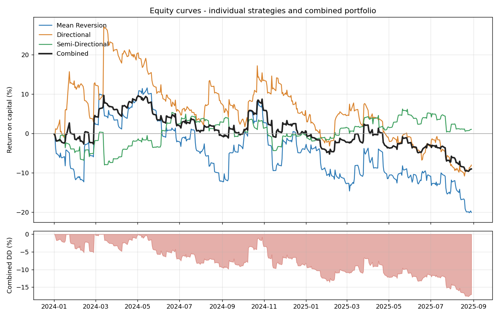

# Holdout test: frozen rules on 2024-01-01 to 2025-08-29

Data: `data/dhan_2023_2025/nifty_opt_1min.parquet` | 409 trading days | Frozen snapshot: `frozen/rules_v1.json` (frozen 2026-10-24 00:35:14, commit c10d7a4, last in-sample date 2026-10-16)

Rules, sizing and costs are taken from the snapshot and were not changed for this run.

## Performance

|  | Mean Reversion | Directional | Semi-Directional | Combined |
|---|---|---|---|---|
| Start | 2024-01-01 | 2024-01-01 | 2024-01-01 | 2024-01-01 |
| End | 2025-08-29 | 2025-08-29 | 2025-08-29 | 2025-08-29 |
| Trading days | 409 | 409 | 409 | 409 |
| Final equity | Rs 7,99,138 | Rs 9,19,525 | Rs 10,10,478 | Rs 27,29,140 |
| Total return | -20.1% | -8.0% | 1.0% | -9.0% |
| CAGR | -12.6% | -4.9% | 0.6% | -5.5% |
| Annual volatility | 24.6% | 24.4% | 12.3% | 13.6% |
| Sharpe | -0.44 | -0.10 | 0.11 | -0.36 |
| Sharpe 95% CI low | -2.03 | -1.66 | -1.43 | -1.94 |
| Sharpe 95% CI high | 1.15 | 1.46 | 1.66 | 1.22 |
| P(true Sharpe > 0) | 29.3% | 45.2% | 55.7% | 32.7% |
| Sortino | -0.83 | -0.23 | 0.12 | -0.64 |
| Max drawdown | -28.5% | -29.9% | -9.2% | -17.6% |
| Longest drawdown (days) | 319 | 359 | 224 | 359 |
| Calmar | -0.44 | -0.16 | 0.07 | -0.32 |
| Worst day | -4.33% | -3.00% | -4.74% | -3.23% |
| Best day | 10.21% | 15.47% | 3.96% | 6.75% |
| Days with a trade | 100% | 100% | 100% | 100% |
| Positive months | 40% | 40% | 50% | 40% |
| Trades | 567 | 409 | 409 | 1385 |
| Win rate | 37.4% | 43.3% | 55.7% | 44.5% |
| Avg P&L / trade | Rs -354 | Rs -197 | Rs 26 | Rs -196 |
| Avg win | Rs 8,354 | Rs 10,132 | Rs 3,857 | Rs 7,202 |
| Avg loss | Rs -5,555 | Rs -8,077 | Rs -4,801 | Rs -6,139 |
| Avg win / avg loss | 1.50 | 1.25 | 0.80 | 1.17 |
| Profit factor | 0.90 | 0.96 | 1.01 | 0.94 |
| Best trade | Rs 48,932 | Rs 1,70,468 | Rs 38,406 | Rs 1,70,468 |
| Worst trade | Rs -17,586 | Rs -33,562 | Rs -47,570 | Rs -47,570 |
| Max consecutive losses | 17 | 9 | 6 | 17 |
| Avg holding time | 259 min | 308 min | 170 min | 247 min |
| Gross P&L (after slippage) | Rs -1,55,277 | Rs -42,824 | Rs 62,785 | Rs -1,35,317 |
| Charges | Rs 45,585 | Rs 37,651 | Rs 52,307 | Rs 1,35,543 |
| Charges / gross profits | 3% | 2% | 6% | 3% |

## By calendar year

|  | Total return | CAGR | Sharpe | Sharpe 95% CI low | Sharpe 95% CI high | Max drawdown | Calmar | Trades | Win rate |
|---|---|---|---|---|---|---|---|---|---|
| Mean Reversion 2024 | -3.4% | -3.4% | -0.00 | -2.00 | 1.99 | -21.4% | -0.16 | 337 | 37.7% |
| Mean Reversion 2025 | -17.3% | -25.1% | -1.27 | -3.87 | 1.34 | -17.9% | -1.40 | 230 | 37.0% |
| Directional 2024 | 5.8% | 5.8% | 0.34 | -1.57 | 2.25 | -20.1% | 0.29 | 245 | 40.8% |
| Directional 2025 | -13.1% | -19.3% | -1.33 | -3.85 | 1.19 | -17.3% | -1.12 | 164 | 47.0% |
| Semi-Directional 2024 | -0.5% | -0.5% | 0.04 | -1.96 | 2.03 | -9.2% | -0.05 | 245 | 54.3% |
| Semi-Directional 2025 | 1.5% | 2.3% | 0.29 | -2.17 | 2.75 | -5.5% | 0.42 | 164 | 57.9% |
| Combined 2024 | 0.7% | 0.7% | 0.12 | -1.86 | 2.09 | -9.9% | 0.07 | 827 | 43.5% |
| Combined 2025 | -9.6% | -14.3% | -1.35 | -3.96 | 1.27 | -11.7% | -1.22 | 558 | 46.1% |

## By day type

| strategy / day_type | trades | win rate | avg P&L (Rs) | total P&L (Rs) |
|---|---|---|---|---|
| Directional / DTE 1 | 79 | 39% | -524 | -41,422 |
| Directional / expiry (DTE 0) | 87 | 71% | -153 | -13,285 |
| Directional / far (2+ days) | 243 | 35% | -106 | -25,768 |
| Mean Reversion / DTE 1 | 237 | 42% | 270 | 64,062 |
| Mean Reversion / expiry (DTE 0) | 87 | 32% | -2,102 | -1,82,910 |
| Mean Reversion / far (2+ days) | 243 | 35% | -338 | -82,014 |
| Semi-Directional / DTE 1 | 79 | 59% | 1,412 | 1,11,567 |
| Semi-Directional / expiry (DTE 0) | 87 | 57% | -763 | -66,419 |
| Semi-Directional / far (2+ days) | 243 | 54% | -143 | -34,670 |

| net P&L by day type (Rs) | Directional | Mean Reversion | Semi-Directional | Combined |
|---|---|---|---|---|
| DTE 1 | -41,422 | 64,062 | 1,11,567 | 1,34,207 |
| expiry (DTE 0) | -13,285 | -1,82,910 | -66,419 | -2,62,614 |
| far (2+ days) | -25,768 | -82,014 | -34,670 | -1,42,452 |

## Holdout vs in-sample

|  | Mean Reversion | Directional | Semi-Directional | Combined |
|---|---|---|---|---|
| CAGR: in-sample | 52.7% | 33.2% | 26.8% | 37.6% |
| CAGR: holdout | -12.6% | -4.9% | 0.6% | -5.5% |
| Sharpe: in-sample | 1.74 | 1.58 | 2.26 | 2.31 |
| Sharpe: holdout | -0.44 | -0.10 | 0.11 | -0.36 |
| Sharpe 95% CI low: in-sample | 0.08 | -0.14 | 0.40 | 0.71 |
| Sharpe 95% CI low: holdout | -2.03 | -1.66 | -1.43 | -1.94 |
| Sharpe 95% CI high: in-sample | 3.40 | 3.29 | 4.12 | 3.90 |
| Sharpe 95% CI high: holdout | 1.15 | 1.46 | 1.66 | 1.22 |
| Max drawdown: in-sample | -9.9% | -12.8% | -4.4% | -7.3% |
| Max drawdown: holdout | -28.5% | -29.9% | -9.2% | -17.6% |
| Calmar: in-sample | 5.33 | 2.60 | 6.12 | 5.12 |
| Calmar: holdout | -0.44 | -0.16 | 0.07 | -0.32 |
| Win rate: in-sample | 42.2% | 50.4% | 55.4% | 48.5% |
| Win rate: holdout | 37.4% | 43.3% | 55.7% | 44.5% |
| Profit factor: in-sample | 1.45 | 1.37 | 1.68 | 1.46 |
| Profit factor: holdout | 0.90 | 0.96 | 1.01 | 0.94 |

## Correlation of daily returns

|  | Mean Reversion | Directional | Semi-Directional |
|---|---|---|---|
| Mean Reversion | 1.0 | 0.13 | 0.54 |
| Directional | 0.13 | 1.0 | -0.2 |
| Semi-Directional | 0.54 | -0.2 | 1.0 |

## Monthly returns

| Month | Mean Reversion | Directional | Semi-Directional | Combined |
|---|---|---|---|---|
| 2024-01 | -11.2% | +11.6% | -4.9% | -1.5% |
| 2024-02 | +15.6% | +1.1% | +3.2% | +6.1% |
| 2024-03 | +0.7% | +7.3% | -4.7% | +1.4% |
| 2024-04 | +5.4% | -0.8% | +4.9% | +2.9% |
| 2024-05 | -5.3% | -8.0% | -1.6% | -5.2% |
| 2024-06 | -5.0% | -4.1% | +6.0% | -1.2% |
| 2024-07 | -3.2% | -2.8% | +0.6% | -1.8% |
| 2024-08 | -7.3% | +4.5% | -0.1% | -0.8% |
| 2024-09 | +9.7% | -3.9% | -3.0% | +0.4% |
| 2024-10 | +6.5% | +9.7% | +1.5% | +5.9% |
| 2024-11 | -4.5% | -3.5% | -1.9% | -3.3% |
| 2024-12 | -1.5% | -3.5% | +0.2% | -1.7% |
| 2025-01 | -7.5% | -7.7% | -1.1% | -5.5% |
| 2025-02 | -2.3% | +7.0% | +3.2% | +2.8% |
| 2025-03 | +8.6% | +2.8% | +2.4% | +4.4% |
| 2025-04 | -6.6% | -7.7% | -2.3% | -5.5% |
| 2025-05 | +0.2% | +0.1% | +3.1% | +1.2% |
| 2025-06 | +0.5% | -2.5% | +0.3% | -0.6% |
| 2025-07 | -1.1% | -4.8% | -2.6% | -2.9% |
| 2025-08 | -9.3% | -0.2% | -1.3% | -3.4% |

## Exit reasons

| strategy / reason | trades | win rate | avg P&L (Rs) | total P&L (Rs) |
|---|---|---|---|---|
| Directional / square-off | 390 | 45% | 869 | 3,39,100 |
| Directional / stop | 19 | 0% | -22,083 | -4,19,575 |
| Mean Reversion / square-off | 445 | 41% | 672 | 2,99,257 |
| Mean Reversion / stop | 52 | 0% | -9,321 | -4,84,714 |
| Mean Reversion / time exit | 70 | 40% | -220 | -15,406 |
| Semi-Directional / square-off | 79 | 59% | 1,412 | 1,11,567 |
| Semi-Directional / time exit | 330 | 55% | -306 | -1,01,089 |

## Where the frozen rules ranked in the 2023-2025 search

Rank by t-statistic among the candidates for the same day type in `data/dhan_2023_2025/search/scores.csv`. That search covered this data, so this window is a holdout for the final rules but not data nobody has looked at.

| strategy | day type | rule | rank (by t) | t-stat | search P&L 2024 (Rs) | search P&L 2025 (Rs) |
|---|---|---|---|---|---|---|
| Mean Reversion | far (2+ days) | open fade 10:00 long exit 15:15 stop 0.0 | 31 of 2046 | 0.07 | -18,985 | -67,419 |
| Mean Reversion | DTE 1 | pc fade 10:20 long exit 15:15 stop 1.0 | not in search |  |  |  |
| Mean Reversion | DTE 1 | pc fade 10:35 long exit 15:15 stop 1.0 | not in search |  |  |  |
| Mean Reversion | DTE 1 | pc fade 10:50 long exit 15:15 stop 1.0 | not in search |  |  |  |
| Mean Reversion | expiry (DTE 0) | open fade 10:00 debit6 exit 12:00 stop 1.0 | 1636 of 2046 | -1.84 | -65,177 | -1,41,052 |
| Directional | far (2+ days) | pcr follow 10:00 long exit 15:15 stop 0.0 | 306 of 2046 | -0.92 | 51,657 | -79,738 |
| Directional | DTE 1 | pcr follow 10:15 long exit 15:15 stop 1.0 | 222 of 2046 | 0.67 | 20,146 | -56,488 |
| Directional | expiry (DTE 0) | pcr follow 09:55 credit5 exit 15:15 stop 0.0 | not in search |  |  |  |
| Semi-Directional | far (2+ days) | pc follow 09:30 otmcredit3 exit 12:00 stop 0.0 | 817 of 2046 | -1.78 | -69,655 | 13,132 |
| Semi-Directional | DTE 1 | pc fade 10:30 credit5 exit 15:15 stop 0.0 | 119 of 2046 | 0.92 | 17,346 | 8,707 |
| Semi-Directional | expiry (DTE 0) | open fade 10:00 credit5 exit 12:00 stop 0.0 | 1367 of 2046 | -1.26 | -6,437 | -17,344 |

## Market regime in the window

| period | days | lot size | expiry weekday |
|---|---|---|---|
| 2024Q1 | 60 | 50 | Thu |
| 2024Q2 | 60 | 25 | Thu, Wed |
| 2024Q3 | 64 | 25 | Thu, Wed |
| 2024Q4 | 61 | 25/75 | Thu |
| 2025Q1 | 61 | 75 | Thu |
| 2025Q2 | 61 | 75 | Thu, Wed |
| 2025Q3 | 42 | 75 | Thu, Tue |

## Skipped days
0 days with fewer than 300 one-minute bars: none
