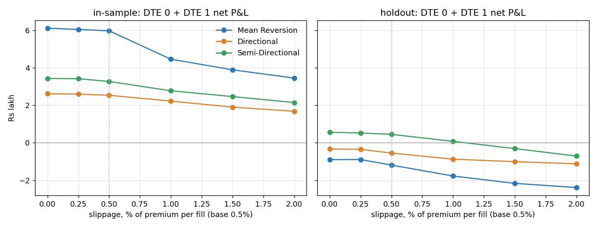

# Slippage and fill sensitivity

Frozen rules (`frozen/rules_v1.json`). Each group changes one assumption from the base (slippage max(0.25 pts, 0.5%) per fill, fill at the next bar's open). Net P&L in Rs; 'expiry' = DTE 0, 'far' = 2+ days to expiry.

## Break-even slippage for DTE 0 + DTE 1 trades

| period | strategy | break-even slippage (DTE 0 + DTE 1) |
|---|---|---|
| in-sample | Mean Reversion | above 5% |
| in-sample | Directional | 4.98% of premium per fill |
| in-sample | Semi-Directional | above 5% |
| holdout | Mean Reversion | already negative at 0% |
| holdout | Directional | already negative at 0% |
| holdout | Semi-Directional | 1.19% of premium per fill |

## in-sample: slippage %

DTE 0 + DTE 1 net P&L (Rs)

| assumption | Mean Reversion | Directional | Semi-Directional | Combined |
|---|---|---|---|---|
| max(0.25 pts, 0.00%) | 6,11,816 | 2,61,977 | 3,43,518 | 12,17,311 |
| max(0.25 pts, 0.25%) | 6,05,025 | 2,59,855 | 3,41,916 | 12,06,795 |
| max(0.25 pts, 0.50%) | 5,97,661 | 2,53,589 | 3,27,548 | 11,78,798 |
| max(0.25 pts, 1.00%) | 4,46,315 | 2,22,551 | 2,77,662 | 9,46,527 |
| max(0.25 pts, 1.50%) | 3,89,503 | 1,90,619 | 2,46,620 | 8,26,741 |
| max(0.25 pts, 2.00%) | 3,45,220 | 1,68,138 | 2,14,867 | 7,28,225 |

Overall Sharpe (all day types)

| assumption | Mean Reversion | Directional | Semi-Directional |
|---|---|---|---|
| max(0.25 pts, 0.00%) | 1.78 | 1.65 | 2.41 |
| max(0.25 pts, 0.25%) | 1.76 | 1.65 | 2.38 |
| max(0.25 pts, 0.50%) | 1.74 | 1.58 | 2.26 |
| max(0.25 pts, 1.00%) | 1.44 | 1.46 | 1.88 |
| max(0.25 pts, 1.50%) | 1.25 | 1.26 | 1.57 |
| max(0.25 pts, 2.00%) | 1.1 | 1.13 | 1.21 |

## in-sample: slippage floor

DTE 0 + DTE 1 net P&L (Rs)

| assumption | Mean Reversion | Directional | Semi-Directional | Combined |
|---|---|---|---|---|
| max(0.25 pts, 0.50%) | 5,97,661 | 2,53,589 | 3,27,548 | 11,78,798 |
| max(0.5 pts, 0.50%) | 5,07,368 | 2,44,896 | 2,80,321 | 10,32,585 |
| max(1.0 pts, 0.50%) | 3,51,797 | 2,05,315 | 2,09,383 | 7,66,495 |
| max(2.0 pts, 0.50%) | 1,57,657 | 1,35,541 | 69,745 | 3,62,943 |

Overall Sharpe (all day types)

| assumption | Mean Reversion | Directional | Semi-Directional |
|---|---|---|---|
| max(0.25 pts, 0.50%) | 1.74 | 1.58 | 2.26 |
| max(0.5 pts, 0.50%) | 1.56 | 1.54 | 1.96 |
| max(1.0 pts, 0.50%) | 1.2 | 1.43 | 1.37 |
| max(2.0 pts, 0.50%) | 0.62 | 1.07 | -0.15 |

## in-sample: fill

DTE 0 + DTE 1 net P&L (Rs)

| assumption | Mean Reversion | Directional | Semi-Directional | Combined |
|---|---|---|---|---|
| next open | 5,97,661 | 2,53,589 | 3,27,548 | 11,78,798 |
| next close | 5,29,827 | 2,65,164 | 2,92,441 | 10,87,432 |
| open +1 bar | 5,29,892 | 2,63,272 | 2,98,147 | 10,91,311 |
| open +2 bars | 5,27,074 | 2,51,519 | 3,00,940 | 10,79,533 |

Overall Sharpe (all day types)

| assumption | Mean Reversion | Directional | Semi-Directional |
|---|---|---|---|
| next open | 1.74 | 1.58 | 2.26 |
| next close | 1.59 | 1.51 | 2.07 |
| open +1 bar | 1.61 | 1.61 | 2.14 |
| open +2 bars | 1.6 | 1.61 | 2.21 |

## holdout: slippage %

DTE 0 + DTE 1 net P&L (Rs)

| assumption | Mean Reversion | Directional | Semi-Directional | Combined |
|---|---|---|---|---|
| max(0.25 pts, 0.00%) | -89,912 | -33,242 | 56,373 | -66,780 |
| max(0.25 pts, 0.25%) | -89,237 | -34,839 | 52,257 | -71,818 |
| max(0.25 pts, 0.50%) | -1,18,848 | -54,707 | 45,148 | -1,28,408 |
| max(0.25 pts, 1.00%) | -1,77,294 | -87,331 | 7,767 | -2,56,859 |
| max(0.25 pts, 1.50%) | -2,16,445 | -1,00,554 | -30,917 | -3,47,916 |
| max(0.25 pts, 2.00%) | -2,38,716 | -1,11,967 | -70,677 | -4,21,360 |

Overall Sharpe (all day types)

| assumption | Mean Reversion | Directional | Semi-Directional |
|---|---|---|---|
| max(0.25 pts, 0.00%) | -0.31 | -0.01 | 0.24 |
| max(0.25 pts, 0.25%) | -0.32 | -0.01 | 0.21 |
| max(0.25 pts, 0.50%) | -0.44 | -0.1 | 0.11 |
| max(0.25 pts, 1.00%) | -0.75 | -0.31 | -0.21 |
| max(0.25 pts, 1.50%) | -1.0 | -0.49 | -0.59 |
| max(0.25 pts, 2.00%) | -1.18 | -0.63 | -0.96 |

## holdout: slippage floor

DTE 0 + DTE 1 net P&L (Rs)

| assumption | Mean Reversion | Directional | Semi-Directional | Combined |
|---|---|---|---|---|
| max(0.25 pts, 0.50%) | -1,18,848 | -54,707 | 45,148 | -1,28,408 |
| max(0.5 pts, 0.50%) | -1,44,047 | -64,930 | 607 | -2,08,369 |
| max(1.0 pts, 0.50%) | -2,46,972 | -1,02,285 | -77,248 | -4,26,506 |
| max(2.0 pts, 0.50%) | -3,58,687 | -1,48,621 | -1,95,679 | -7,02,987 |

Overall Sharpe (all day types)

| assumption | Mean Reversion | Directional | Semi-Directional |
|---|---|---|---|
| max(0.25 pts, 0.50%) | -0.44 | -0.1 | 0.11 |
| max(0.5 pts, 0.50%) | -0.53 | -0.11 | -0.16 |
| max(1.0 pts, 0.50%) | -1.0 | -0.31 | -0.78 |
| max(2.0 pts, 0.50%) | -1.62 | -0.62 | -2.05 |

## holdout: fill

DTE 0 + DTE 1 net P&L (Rs)

| assumption | Mean Reversion | Directional | Semi-Directional | Combined |
|---|---|---|---|---|
| next open | -1,18,848 | -54,707 | 45,148 | -1,28,408 |
| next close | -1,22,963 | -40,459 | 49,886 | -1,13,537 |
| open +1 bar | -1,29,432 | -45,597 | 34,190 | -1,40,839 |
| open +2 bars | -1,20,177 | -11,708 | 59,844 | -72,041 |

Overall Sharpe (all day types)

| assumption | Mean Reversion | Directional | Semi-Directional |
|---|---|---|---|
| next open | -0.44 | -0.1 | 0.11 |
| next close | -0.48 | -0.1 | 0.15 |
| open +1 bar | -0.49 | -0.04 | 0.07 |
| open +2 bars | -0.47 | 0.0 | 0.21 |

## Full detail

Every scenario, strategy and day type is in `sensitivity.csv`.
