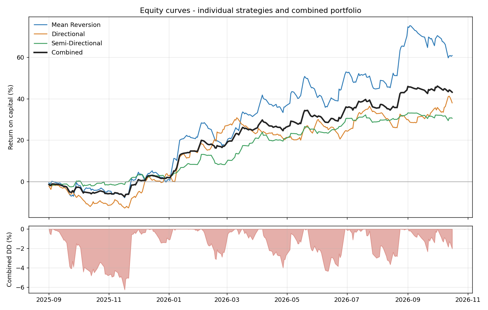
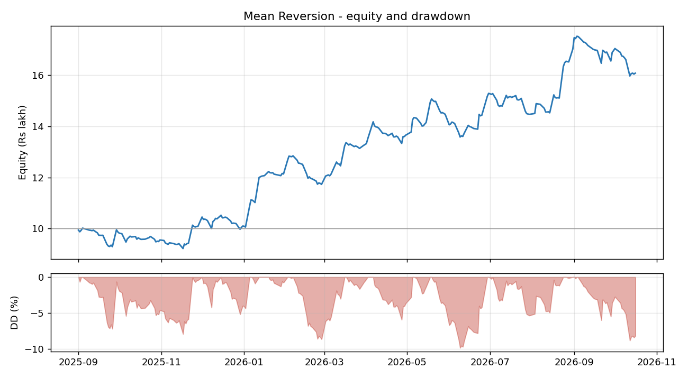
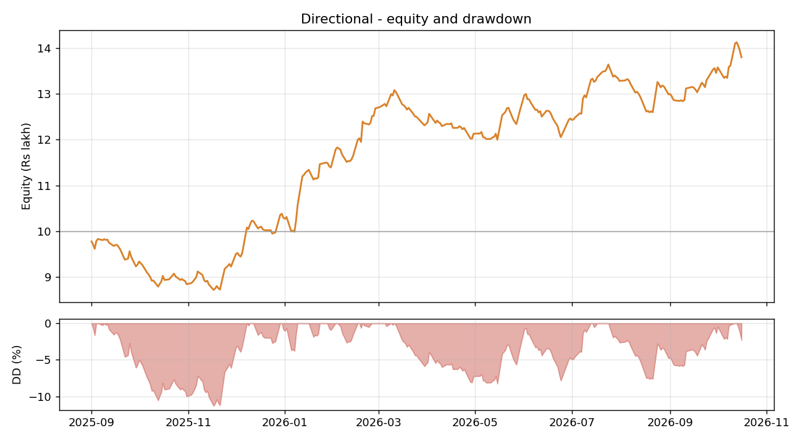
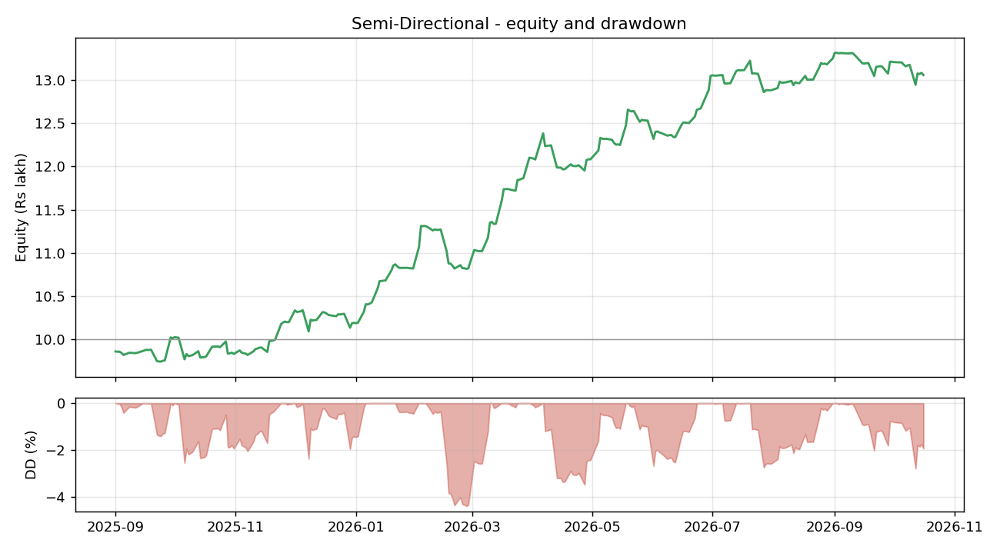

# NIFTY Intraday Options - Three-Strategy Backtest

Data: data/nifty_opt_1min_2y.parquet | Period: 2025-09-01 to 2026-10-16 (278 trading days) | Generated: 2026-10-23 00:49

## Setup

- Capital: Rs 10,00,000 per strategy, Rs 30,00,000 combined (equal allocation, fixed in advance - not optimised).
- Sizing: lots so that the position's worst-case loss (premium paid, or spread width minus credit) is 2% of the sleeve's equity; max 20 lots; premium outlay <= 20% of equity. Equity compounds.
- Instrument: nearest weekly NIFTY expiry, 1-minute bars from Dhan's expired-options API (ATM+-10 strikes, real strike per bar; expiry from the NSE bhavcopy, weekday rule outside it), lot size as per NSE on each date.
- Every strategy trades once every day, with one rule per day type (3+ days to expiry, day before expiry, expiry day).
- **IN-SAMPLE:** rules and risk multipliers were selected on this same year to make each strategy profitable in both halves and reach a combined Calmar >= 5. An earlier design fixed on the first half alone lost money in the second half. Read these results as a fitted description of this year, not an estimate of future performance.
- Execution: signal on bar close, fill at next bar open; flat by 15:15; no entries after 14:30.
- Slippage: max(0.25 pts, 0.5% of premium) per fill.
- Charges: Rs 20/order brokerage, STT 0.10% on sells, NSE txn 0.03503%, SEBI Rs 10/cr, stamp 0.003% on buys, GST 18%.
- Drawdown is measured on daily closing equity (positions are always flat overnight).

## Equity curves

## Performance statistics

|  | Mean Reversion | Directional | Semi-Directional | Combined |
|---|---|---|---|---|
| Start | 2025-09-01 | 2025-09-01 | 2025-09-01 | 2025-09-01 |
| End | 2026-10-16 | 2026-10-16 | 2026-10-16 | 2026-10-16 |
| Trading days | 278 | 278 | 278 | 278 |
| Final equity | Rs 16,08,025 | Rs 13,79,609 | Rs 13,05,350 | Rs 42,92,985 |
| Total return | 60.8% | 38.0% | 30.5% | 43.1% |
| CAGR | 52.7% | 33.2% | 26.8% | 37.6% |
| Annual volatility | 26.8% | 19.7% | 11.0% | 14.6% |
| Sharpe | 1.74 | 1.58 | 2.26 | 2.31 |
| Sharpe 95% CI low | 0.08 | -0.14 | 0.40 | 0.71 |
| Sharpe 95% CI high | 3.40 | 3.29 | 4.12 | 3.90 |
| P(true Sharpe > 0) | 98.0% | 96.4% | 99.1% | 99.8% |
| Sortino | 3.76 | 3.44 | 2.87 | 4.94 |
| Max drawdown | -9.9% | -12.8% | -4.4% | -7.3% |
| Longest drawdown (days) | 52 | 80 | 33 | 61 |
| Calmar | 5.33 | 2.60 | 6.12 | 5.12 |
| Worst day | -3.86% | -3.05% | -2.48% | -2.55% |
| Best day | 8.88% | 5.95% | 2.72% | 5.53% |
| Days with a trade | 100% | 100% | 100% | 100% |
| Positive months | 57% | 57% | 57% | 71% |
| Trades | 384 | 278 | 278 | 940 |
| Win rate | 42.2% | 50.4% | 55.4% | 48.5% |
| Avg P&L / trade | Rs 1,583 | Rs 1,365 | Rs 1,098 | Rs 1,376 |
| Avg win | Rs 12,060 | Rs 10,138 | Rs 4,878 | Rs 9,044 |
| Avg loss | Rs -6,061 | Rs -7,534 | Rs -3,595 | Rs -5,849 |
| Avg win / avg loss | 1.99 | 1.35 | 1.36 | 1.55 |
| Profit factor | 1.45 | 1.37 | 1.68 | 1.46 |
| Best trade | Rs 57,708 | Rs 65,829 | Rs 30,184 | Rs 65,829 |
| Worst trade | Rs -22,920 | Rs -31,489 | Rs -25,617 | Rs -31,489 |
| Max consecutive losses | 15 | 7 | 5 | 15 |
| Avg holding time | 265 min | 309 min | 169 min | 250 min |
| Gross P&L (after slippage) | Rs 6,42,660 | Rs 4,06,249 | Rs 3,41,236 | Rs 13,90,145 |
| Charges | Rs 34,635 | Rs 26,640 | Rs 35,885 | Rs 97,160 |
| Charges / gross profits | 2% | 2% | 5% | 2% |

Combined Calmar = 5.12 (target >= 5: met). Combined Sharpe 2.31, 95% CI [0.71, 3.90].

## First half vs second half

Same parameters throughout. The parameters were selected on the full year (in-sample), including a requirement to be profitable in both halves, so this table shows stability within the fitted year, not out-of-sample performance.

| split at 2026-04-01 | CAGR | Sharpe | Sharpe 95% CI low | Sharpe 95% CI high | Max drawdown | Calmar | Trades | Win rate | Avg P&L / trade |
|---|---|---|---|---|---|---|---|---|---|
| Mean Reversion first half | 63.2% | 1.92 | -0.32 | 4.16 | -8.7% | 7.28 | 196 | 43.4% | Rs 1,660 |
| Mean Reversion second half | 42.8% | 1.53 | -0.94 | 4.00 | -9.9% | 4.33 | 188 | 41.0% | Rs 1,503 |
| Directional first half | 43.5% | 1.79 | -0.59 | 4.18 | -12.8% | 3.40 | 142 | 50.7% | Rs 1,626 |
| Directional second half | 23.4% | 1.31 | -1.18 | 3.81 | -7.6% | 3.06 | 136 | 50.0% | Rs 1,093 |
| Semi-Directional first half | 39.3% | 2.85 | 0.23 | 5.47 | -4.4% | 8.98 | 142 | 58.5% | Rs 1,479 |
| Semi-Directional second half | 15.0% | 1.51 | -1.16 | 4.19 | -3.5% | 4.33 | 136 | 52.2% | Rs 701 |
| Combined first half | 48.5% | 2.74 | 0.57 | 4.91 | -7.3% | 6.61 | 480 | 50.0% | Rs 1,597 |
| Combined second half | 27.3% | 1.81 | -0.56 | 4.18 | -4.3% | 6.30 | 460 | 47.0% | Rs 1,145 |

## Correlation of daily returns

|  | Mean Reversion | Directional | Semi-Directional |
|---|---|---|---|
| Mean Reversion | 1.00 | 0.16 | 0.77 |
| Directional | 0.16 | 1.00 | -0.00 |
| Semi-Directional | 0.77 | -0.00 | 1.00 |

## Parameter robustness

Each strategy re-run with its key parameters moved around the defaults. Results that collapse when a parameter moves one notch are a sign of overfitting.

| strategy | configs | sharpe_min | sharpe_median | sharpe_max | pct_positive | calmar_median |
|---|---|---|---|---|---|---|
| Directional | 9 | 0.92 | 1.45 | 2.0 | 100% | 2.27 |
| Mean Reversion | 9 | 1.04 | 1.35 | 1.81 | 100% | 3.13 |
| Semi-Directional | 9 | 1.38 | 1.97 | 2.31 | 100% | 4.74 |

## Stress test

Each strategy re-run with one setting changed at a time, for each day type: signal time +-10/20 min, exit time +-30/60 min, each alternative stop width and each alternative option structure.

| strategy | variants | sharpe_min | sharpe_median | profitable_both_halves |
|---|---|---|---|---|
| Mean Reversion | 42 | 1.13 | 1.57 | 42 of 42 |
| Directional | 41 | 0.91 | 1.53 | 41 of 41 |
| Semi-Directional | 39 | 1.51 | 2.25 | 39 of 39 |

## Breakdown by exit reason

| strategy / reason | trades | win rate | avg P&L (Rs) | total P&L (Rs) |
|---|---|---|---|---|
| Directional / square-off | 270 | 52% | 2,038 | 5,50,167 |
| Directional / stop | 8 | 0% | -21,320 | -1,70,558 |
| Mean Reversion / square-off | 302 | 45% | 2,381 | 7,19,157 |
| Mean Reversion / stop | 28 | 0% | -13,285 | -3,71,994 |
| Mean Reversion / time exit | 54 | 46% | 4,831 | 2,60,862 |
| Semi-Directional / square-off | 53 | 60% | 2,453 | 1,30,016 |
| Semi-Directional / time exit | 225 | 54% | 779 | 1,75,334 |

## Breakdown by days to expiry

| strategy / dte | trades | win rate | avg P&L (Rs) | total P&L (Rs) |
|---|---|---|---|---|
| Directional / 0 | 59 | 75% | 647 | 38,148 |
| Directional / 1 | 53 | 45% | 4,065 | 2,15,441 |
| Directional / 3 | 5 | 20% | -4,003 | -20,014 |
| Directional / 4 | 54 | 43% | 278 | 15,014 |
| Directional / 5 | 55 | 58% | 3,679 | 2,02,335 |
| Directional / 6 | 52 | 31% | -1,371 | -71,315 |
| Mean Reversion / 0 | 59 | 42% | 3,040 | 1,79,354 |
| Mean Reversion / 1 | 159 | 44% | 2,631 | 4,18,307 |
| Mean Reversion / 3 | 5 | 20% | -2,768 | -13,842 |
| Mean Reversion / 4 | 54 | 35% | -724 | -39,107 |
| Mean Reversion / 5 | 55 | 47% | 845 | 46,452 |
| Mean Reversion / 6 | 52 | 40% | 324 | 16,860 |
| Semi-Directional / 0 | 59 | 63% | 3,348 | 1,97,532 |
| Semi-Directional / 1 | 53 | 60% | 2,453 | 1,30,016 |
| Semi-Directional / 3 | 5 | 80% | 247 | 1,236 |
| Semi-Directional / 4 | 54 | 57% | -129 | -6,953 |
| Semi-Directional / 5 | 55 | 47% | -228 | -12,538 |
| Semi-Directional / 6 | 52 | 46% | -76 | -3,943 |

## Breakdown by direction

| strategy / direction | trades | win rate | avg P&L (Rs) | total P&L (Rs) |
|---|---|---|---|---|
| Directional / long | 106 | 48% | 945 | 1,00,164 |
| Directional / short | 172 | 52% | 1,625 | 2,79,445 |
| Mean Reversion / long | 184 | 45% | 1,819 | 3,34,719 |
| Mean Reversion / short | 200 | 40% | 1,367 | 2,73,306 |
| Semi-Directional / long | 155 | 54% | 1,185 | 1,83,683 |
| Semi-Directional / short | 123 | 58% | 989 | 1,21,668 |

## Monthly returns

| Month | Mean Reversion | Directional | Semi-Directional | Combined |
|---|---|---|---|---|
| 2025-09 | -1.3% | -7.3% | +0.2% | -2.8% |
| 2025-10 | -3.2% | -4.6% | -1.8% | -3.2% |
| 2025-11 | +5.6% | +4.3% | +3.7% | +4.6% |
| 2025-12 | +0.1% | +11.5% | -0.1% | +3.6% |
| 2026-01 | +20.2% | +10.7% | +6.1% | +12.3% |
| 2026-02 | -3.4% | +11.3% | +0.0% | +2.6% |
| 2026-03 | +13.0% | -2.9% | +11.8% | +6.9% |
| 2026-04 | +3.0% | -1.5% | -0.2% | +0.5% |
| 2026-05 | +6.0% | +3.9% | +3.7% | +4.6% |
| 2026-06 | +5.6% | -1.1% | +4.1% | +3.0% |
| 2026-07 | -5.3% | +6.6% | -1.3% | -0.4% |
| 2026-08 | +17.6% | -2.2% | +2.9% | +6.5% |
| 2026-09 | -0.4% | +3.6% | -0.3% | +0.8% |
| 2026-10 | -5.2% | +2.5% | -1.2% | -1.6% |

## Analysis

See [ANALYSIS.md](ANALYSIS.md) for the written review of each strategy's strengths and weaknesses.
