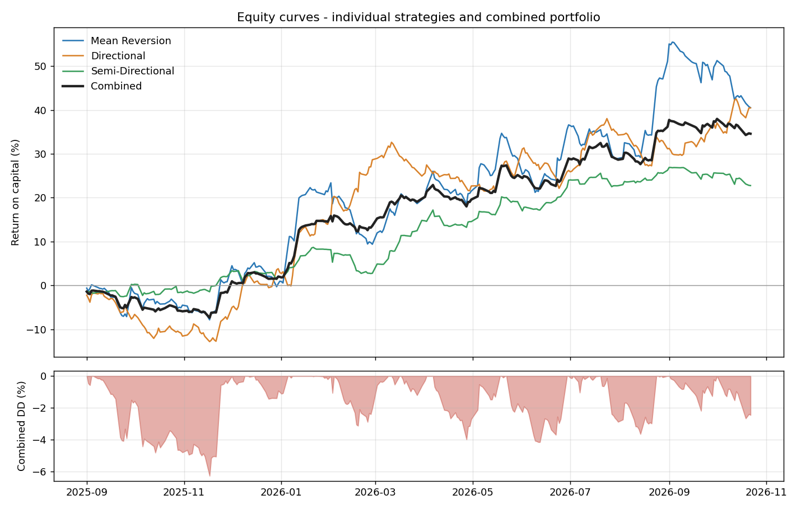
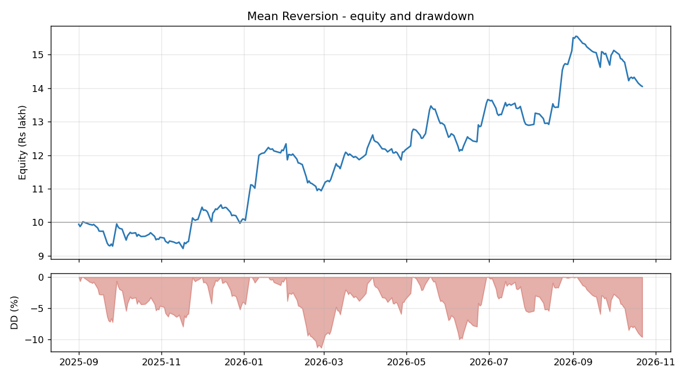
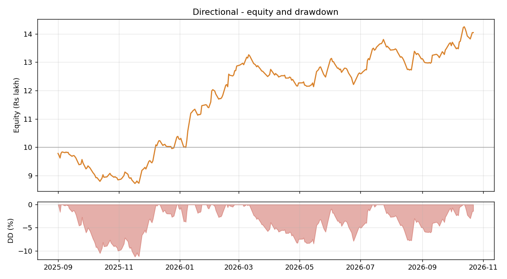
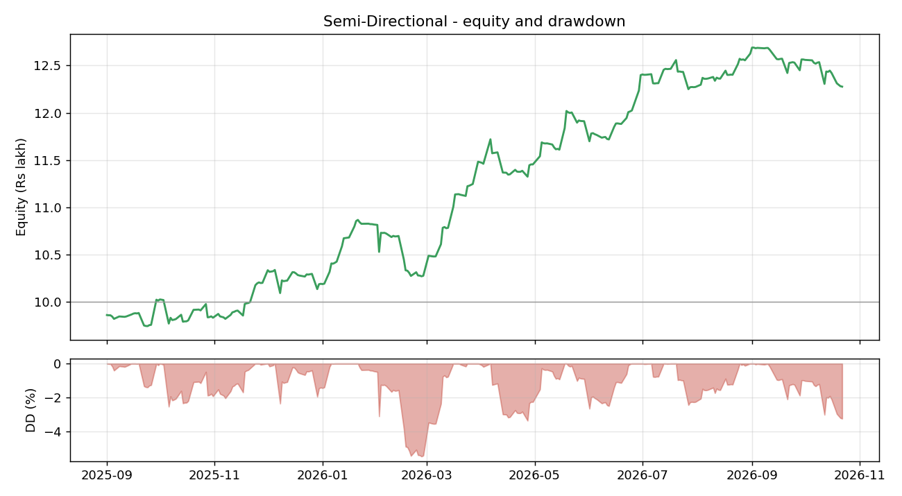

# NIFTY Intraday Options - Three-Strategy Backtest

Data: C:/Users/yashc/AppData/Local/Temp/claude/C--Users-yashc-OneDrive-Desktop-Code-and-Data-Portfolio/44bfc0b8-a145-43fa-abdf-58daf2b3b134/scratchpad/nifty_options_1min_converted.parquet | Period: 2025-09-01 to 2026-10-22 (282 trading days) | Generated: 2026-10-23 12:40

## Setup

- Capital: Rs 10,00,000 per strategy, Rs 30,00,000 combined (equal allocation, fixed in advance - not optimised).
- Sizing: lots so that the position's worst-case loss (premium paid, or spread width minus credit) is 2% of the sleeve's equity; max 20 lots; premium outlay <= 20% of equity. Equity compounds.
- Instrument: nearest weekly NIFTY expiry, 1-minute bars from Dhan's expired-options API (ATM+-10 strikes, real strike per bar; expiry from the NSE bhavcopy, weekday rule outside it), lot size as per NSE on each date.
- Every strategy trades once every day, with one rule per day type (3+ days to expiry, day before expiry, expiry day).
- **IN-SAMPLE:** rules and risk multipliers were selected on this same year to make each strategy profitable in both halves and reach a combined Calmar >= 5. An earlier design fixed on the first half alone lost money in the second half. Read these results as a fitted description of this year, not an estimate of future performance.
- Execution: signal on bar close, fill at next bar open; flat by 15:15; no entries after 14:30.
- Slippage: max(0.25 pts, 0.5% of premium) per fill.
- Charges: Rs 20/order brokerage, STT 0.10% on sells, NSE txn 0.03503%, SEBI Rs 10/cr, stamp 0.003% on buys, GST 18%.
- Drawdown is measured on daily closing equity (positions are always flat overnight).

## Equity curves

## Performance statistics

|  | Mean Reversion | Directional | Semi-Directional | Combined |
|---|---|---|---|---|
| Start | 2025-09-01 | 2025-09-01 | 2025-09-01 | 2025-09-01 |
| End | 2026-10-22 | 2026-10-22 | 2026-10-22 | 2026-10-22 |
| Trading days | 282 | 282 | 282 | 282 |
| Final equity | Rs 14,05,060 | Rs 14,04,611 | Rs 12,27,678 | Rs 40,37,350 |
| Total return | 40.5% | 40.5% | 22.8% | 34.6% |
| CAGR | 34.8% | 34.8% | 19.7% | 29.8% |
| Annual volatility | 26.0% | 19.6% | 10.9% | 13.9% |
| Sharpe | 1.30 | 1.65 | 1.73 | 1.98 |
| Sharpe 95% CI low | -0.40 | -0.06 | -0.14 | 0.37 |
| Sharpe 95% CI high | 3.00 | 3.35 | 3.61 | 3.59 |
| P(true Sharpe > 0) | 93.2% | 97.1% | 96.5% | 99.2% |
| Sortino | 2.61 | 3.58 | 2.09 | 4.11 |
| Max drawdown | -11.3% | -12.8% | -5.5% | -7.3% |
| Longest drawdown (days) | 52 | 80 | 36 | 61 |
| Calmar | 3.07 | 2.72 | 3.60 | 4.05 |
| Worst day | -3.86% | -3.05% | -2.64% | -2.55% |
| Best day | 8.88% | 5.95% | 2.72% | 5.53% |
| Days with a trade | 100% | 100% | 100% | 100% |
| Positive months | 57% | 57% | 50% | 57% |
| Trades | 388 | 282 | 282 | 952 |
| Win rate | 41.2% | 50.7% | 54.3% | 47.9% |
| Avg P&L / trade | Rs 1,044 | Rs 1,435 | Rs 807 | Rs 1,090 |
| Avg win | Rs 10,879 | Rs 10,243 | Rs 4,558 | Rs 8,559 |
| Avg loss | Rs -5,858 | Rs -7,627 | Rs -3,641 | Rs -5,777 |
| Avg win / avg loss | 1.86 | 1.34 | 1.25 | 1.48 |
| Profit factor | 1.30 | 1.38 | 1.48 | 1.36 |
| Best trade | Rs 50,483 | Rs 65,829 | Rs 26,532 | Rs 65,829 |
| Worst trade | Rs -19,095 | Rs -31,489 | Rs -28,506 | Rs -31,489 |
| Max consecutive losses | 15 | 7 | 5 | 15 |
| Avg holding time | 265 min | 309 min | 169 min | 250 min |
| Gross P&L (after slippage) | Rs 4,38,858 | Rs 4,31,745 | Rs 2,63,655 | Rs 11,34,258 |
| Charges | Rs 33,798 | Rs 27,134 | Rs 35,976 | Rs 96,908 |
| Charges / gross profits | 2% | 2% | 5% | 2% |

Combined Calmar = 4.05 (target >= 5: **not met**). Combined Sharpe 1.98, 95% CI [0.37, 3.59].

## First half vs second half

Same parameters throughout. The parameters were selected on the full year (in-sample), including a requirement to be profitable in both halves, so this table shows stability within the fitted year, not out-of-sample performance.

| split at 2026-04-01 | CAGR | Sharpe | Sharpe 95% CI low | Sharpe 95% CI high | Max drawdown | Calmar | Trades | Win rate | Avg P&L / trade |
|---|---|---|---|---|---|---|---|---|---|
| Mean Reversion first half | 36.4% | 1.29 | -1.08 | 3.65 | -11.3% | 3.21 | 197 | 42.1% | Rs 991 |
| Mean Reversion second half | 33.6% | 1.30 | -1.17 | 3.77 | -10.0% | 3.36 | 191 | 40.3% | Rs 1,098 |
| Directional first half | 47.3% | 1.90 | -0.47 | 4.27 | -12.8% | 3.70 | 143 | 51.0% | Rs 1,744 |
| Directional second half | 23.3% | 1.33 | -1.14 | 3.80 | -7.8% | 2.99 | 139 | 50.4% | Rs 1,117 |
| Semi-Directional first half | 27.2% | 2.07 | -0.61 | 4.74 | -5.5% | 4.96 | 143 | 57.3% | Rs 1,037 |
| Semi-Directional second half | 12.7% | 1.32 | -1.31 | 3.96 | -3.4% | 3.77 | 139 | 51.1% | Rs 571 |
| Combined first half | 36.9% | 2.29 | 0.06 | 4.51 | -7.3% | 5.02 | 483 | 49.3% | Rs 1,228 |
| Combined second half | 23.2% | 1.64 | -0.71 | 4.00 | -4.2% | 5.59 | 469 | 46.5% | Rs 947 |

## Correlation of daily returns

|  | Mean Reversion | Directional | Semi-Directional |
|---|---|---|---|
| Mean Reversion | 1.00 | 0.14 | 0.76 |
| Directional | 0.14 | 1.00 | -0.07 |
| Semi-Directional | 0.76 | -0.07 | 1.00 |

## Parameter robustness

Each strategy re-run with its key parameters moved around the defaults. Results that collapse when a parameter moves one notch are a sign of overfitting.

| strategy | configs | sharpe_min | sharpe_median | sharpe_max | pct_positive | calmar_median |
|---|---|---|---|---|---|---|
| Directional | 9 | 1.16 | 1.65 | 2.1 | 100% | 2.72 |
| Mean Reversion | 9 | 0.98 | 1.14 | 1.54 | 100% | 2.09 |
| Semi-Directional | 9 | 0.79 | 1.42 | 1.78 | 100% | 2.82 |

## Stress test

Each strategy re-run with one setting changed at a time, for each day type: signal time +-10/20 min, exit time +-30/60 min, each alternative stop width and each alternative option structure.

| strategy | variants | sharpe_min | sharpe_median | profitable_both_halves |
|---|---|---|---|---|
| Mean Reversion | 42 | 0.82 | 1.27 | 42 of 42 |
| Directional | 41 | 1.0 | 1.62 | 41 of 41 |
| Semi-Directional | 39 | 0.89 | 1.73 | 39 of 39 |

## Breakdown by exit reason

| strategy / reason | trades | win rate | avg P&L (Rs) | total P&L (Rs) |
|---|---|---|---|---|
| Directional / square-off | 274 | 52% | 2,107 | 5,77,257 |
| Directional / stop | 8 | 0% | -21,581 | -1,72,646 |
| Mean Reversion / square-off | 305 | 44% | 1,798 | 5,48,354 |
| Mean Reversion / stop | 28 | 0% | -12,275 | -3,43,707 |
| Mean Reversion / time exit | 55 | 45% | 3,644 | 2,00,414 |
| Semi-Directional / square-off | 53 | 58% | 1,199 | 63,533 |
| Semi-Directional / time exit | 229 | 53% | 717 | 1,64,146 |

## Breakdown by days to expiry

| strategy / dte | trades | win rate | avg P&L (Rs) | total P&L (Rs) |
|---|---|---|---|---|
| Directional / 0 | 60 | 73% | 463 | 27,768 |
| Directional / 1 | 53 | 45% | 4,033 | 2,13,736 |
| Directional / 2 | 1 | 100% | 20,303 | 20,303 |
| Directional / 3 | 5 | 20% | -4,003 | -20,014 |
| Directional / 4 | 54 | 43% | 278 | 15,014 |
| Directional / 5 | 56 | 59% | 3,546 | 1,98,601 |
| Directional / 6 | 53 | 32% | -958 | -50,797 |
| Mean Reversion / 0 | 60 | 42% | 2,132 | 1,27,941 |
| Mean Reversion / 1 | 159 | 42% | 1,571 | 2,49,805 |
| Mean Reversion / 2 | 1 | 100% | 20,303 | 20,303 |
| Mean Reversion / 3 | 5 | 20% | -2,768 | -13,842 |
| Mean Reversion / 4 | 54 | 35% | -653 | -35,283 |
| Mean Reversion / 5 | 56 | 46% | 774 | 43,325 |
| Mean Reversion / 6 | 53 | 40% | 242 | 12,811 |
| Semi-Directional / 0 | 60 | 62% | 3,124 | 1,87,437 |
| Semi-Directional / 1 | 53 | 58% | 1,199 | 63,533 |
| Semi-Directional / 2 | 1 | 0% | -423 | -423 |
| Semi-Directional / 3 | 5 | 80% | 247 | 1,236 |
| Semi-Directional / 4 | 54 | 57% | -129 | -6,953 |
| Semi-Directional / 5 | 56 | 46% | -207 | -11,603 |
| Semi-Directional / 6 | 53 | 45% | -105 | -5,549 |

## Breakdown by direction

| strategy / direction | trades | win rate | avg P&L (Rs) | total P&L (Rs) |
|---|---|---|---|---|
| Directional / long | 108 | 48% | 797 | 86,050 |
| Directional / short | 174 | 52% | 1,831 | 3,18,562 |
| Mean Reversion / long | 183 | 44% | 972 | 1,77,793 |
| Mean Reversion / short | 205 | 39% | 1,109 | 2,27,267 |
| Semi-Directional / long | 157 | 52% | 808 | 1,26,928 |
| Semi-Directional / short | 125 | 57% | 806 | 1,00,751 |

## Monthly returns

| Month | Mean Reversion | Directional | Semi-Directional | Combined |
|---|---|---|---|---|
| 2025-09 | -1.3% | -7.3% | +0.2% | -2.8% |
| 2025-10 | -3.2% | -4.6% | -1.8% | -3.2% |
| 2025-11 | +5.6% | +4.3% | +3.7% | +4.6% |
| 2025-12 | +0.1% | +11.5% | -0.1% | +3.6% |
| 2026-01 | +20.2% | +10.7% | +6.1% | +12.3% |
| 2026-02 | -9.9% | +12.9% | -5.0% | -0.8% |
| 2026-03 | +9.3% | -2.9% | +11.7% | +5.4% |
| 2026-04 | +1.7% | -1.8% | -0.2% | -0.2% |
| 2026-05 | +6.1% | +3.9% | +4.0% | +4.7% |
| 2026-06 | +5.9% | -1.0% | +4.1% | +3.0% |
| 2026-07 | -5.6% | +6.4% | -1.0% | -0.2% |
| 2026-08 | +17.2% | -2.3% | +2.9% | +5.8% |
| 2026-09 | -0.4% | +3.6% | -0.5% | +0.8% |
| 2026-10 | -6.6% | +3.4% | -2.3% | -2.0% |

## Analysis

See [ANALYSIS.md](ANALYSIS.md) for the written review of each strategy's strengths and weaknesses.
