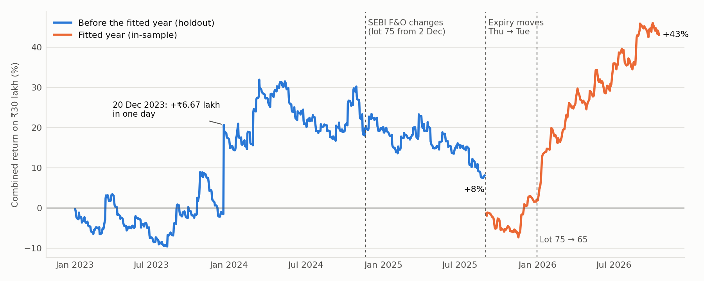
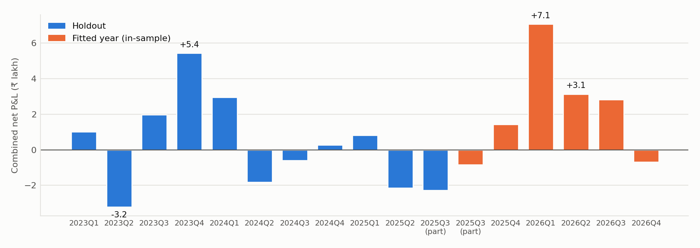

# NIFTY Intraday Option Strategies: Do the Results Depend on Contract Changes?

## Summary

Three intraday NIFTY option strategies, run together on ₹30 lakh, returned +43.1% (Sharpe 2.31) over the year their
rules were chosen on, 1 Sep 2025 – 16 Oct 2026. Run unchanged on 1 Jan 2024 – 29 Aug 2025, the same rules returned
-9.0% (Sharpe -0.36). This document tests whether a change to NIFTY option contracts around that time explains the
difference, which would mean the strategies depend on today's contract rules.

The findings:

- **Lot size** has no material effect: re-running the earlier period at today's lot size gives a Sharpe of 0.23,
  against 0.24 with the actual lot sizes.
- **SEBI's November 2024 reforms:** the months after them were the weakest part of the earlier period (total return
  -9.84%), so there is no sign the strategies needed the post-reform market.
- **The move to Tuesday expiry (1 Sep 2025)** coincides exactly with the start of the fitted year, so it cannot be
  tested directly on history. Indirect checks show no measurable change in option pricing and no link between profit
  and the larger Monday gaps it brought, but the samples are small and these checks cannot exclude it.
- The fitted year's profit is concentrated in 1 Jan – 16 Oct 2026, and 78.2% of its profit on the day before expiry
  came from 10 trading days.

## Background

### The strategies

Three rule-based strategies trade NIFTY weekly index options intraday; every position is closed by 15:15. Each holds
its own ₹10 lakh, so the combined book is ₹30 lakh.

| Strategy | Idea | What it trades |
| --- | --- | --- |
| Mean Reversion | The morning move overshoots and partly reverses | Buys options (or a debit spread) against the morning move |
| Directional | Option open interest near the money points to the day's direction | Buys options in the direction the put/call open-interest ratio suggests |
| Semi-Directional | Selling time value pays if roughly right on direction | Sells a defined-risk credit spread |

Each strategy uses a different rule depending on how many days remain to the weekly expiry:

- **Expiry day** (DTE 0, "days to expiry = 0")
- **The day before expiry** (DTE 1)
- **All other days** ("far" days)

Every position has a known worst-case loss. The number of lots is set so that the worst case equals 2% of the
strategy's current capital, multiplied by a per-rule factor between 0.5 and 3. The larger factors are used on DTE 1
and expiry day. Results include brokerage, statutory charges and slippage of max(0.25 points, 0.5% of premium) per
fill.

### In-sample and holdout

- **In-sample ("fitted year")**, 1 Sep 2025 – 16 Oct 2026, 278 trading days: the period the rules were chosen on.
  An earlier search on 2023–2025 data evaluated 6,138 single-rule candidates; the final rules came from a later
  refit on the fitted year, whose number of candidates was not recorded. The selection criteria were that every
  strategy be profitable in both halves of the year (split 1 Apr 2026) and that the combined Calmar ratio be at
  least 5.
- **Holdout**, 1 Jan 2024 – 29 Aug 2025 (409 trading days), and an extended run from 2 Jan 2023 (654 trading days).
  Before these runs the rules, sizing and cost settings were **frozen**: saved to a file with a timestamp and file
  checksums, and loaded unchanged for every test.

### Headline results

| Combined book (₹30 lakh) | Period | Trading days | Total return | CAGR | Sharpe (95% CI) | Max drawdown |
| --- | --- | --- | --- | --- | --- | --- |
| Fitted year (in-sample) | 1 Sep 2025 – 16 Oct 2026 | 278 | +43.1% | +37.6% | 2.31 (0.71 to 3.90) | -7.3% |
| Holdout | 1 Jan 2024 – 29 Aug 2025 | 409 | -9.0% | -5.5% | -0.36 (-1.94 to 1.22) | -17.6% |
| Holdout, extended | 2 Jan 2023 – 29 Aug 2025 | 654 | +8.1% | +3.0% | 0.24 (-0.89 to 1.37) | -18.6% |

*CAGR: compound annual growth rate. Sharpe: annualised mean of daily returns divided by their annualised standard
deviation. 95% CI: confidence interval for the Sharpe ratio. Max drawdown: largest fall from a previous peak.*

The extended run's net profit over 32 months was ₹2,41,644. One day, 20 Dec 2023, contributed ₹6,66,934. Combined
returns by calendar year were +17.4% (2023), +2.3% (2024) and -10.0% (1 Jan – 29 Aug 2025).

*Figure 1. Combined return of the frozen rules. Each period starts from ₹30 lakh; dashed lines mark the contract
changes.*

## Contract changes over the period

| Change | Official effective date | First date in the data | Falls in |
| --- | --- | --- | --- |
| Lot size 50 → 25 | — | 1 Apr 2024 | Holdout |
| SEBI index-derivative measures (circular of 1 Oct 2024): one weekly-expiry index per exchange, higher minimum contract size, extra margin on expiry day | Phased from 20 Nov 2024 | — | Holdout and fitted year |
| Lot size 25 → 75 (from the new minimum contract size) | New contracts from 20 Nov 2024 | 2 Dec 2024 | Holdout and fitted year |
| NIFTY weekly expiry Thursday → Tuesday (NSE circular 103/2025) | Contracts expiring on or after 1 Sep 2025 | 1 Sep 2025 | **The whole fitted year** |
| Lot size 75 → 65 | 30 Dec 2025 | 31 Dec 2025 | Fitted year, from 31 Dec 2025 |

Later phases of the SEBI measures, including upfront collection of option premium, were reported with effective
dates in 2025; sources differ on the exact dates.

In the fitted year all 53 DTE 1 days were Mondays. In the holdout, 124 of 131 DTE 1 days were Wednesdays and 7 were
Tuesdays (holiday weeks). Because the Tuesday expiry and the fitted year begin on the same day, a comparison of the
two periods alone cannot separate two explanations:

1. The rules were fitted to one period and do not generalise.
2. The rules depend on a contract feature present only in the fitted year.

Each contract change was tested separately.

## Tests and results

### Test 1: Lot size

Lot size affects how finely positions can be sized; the risk budget sets the position size. Both periods were
re-run with every day's lot size replaced by a single value, all else unchanged.

| Combined CAGR / Sharpe | Actual lot sizes | All lot 25 | All lot 50 | All lot 65 | All lot 75 |
| --- | --- | --- | --- | --- | --- |
| Holdout (2 Jan 2023 – 29 Aug 2025) | +3.0% / 0.24 | +3.4% / 0.27 | +2.8% / 0.23 | +2.7% / 0.23 | +3.0% / 0.24 |
| Fitted year | +37.6% / 2.31 | +37.0% / 2.22 | +35.6% / 2.18 | +35.6% / 2.25 | +36.6% / 2.33 |

The holdout Sharpe stays between 0.23 and 0.27 at every lot size, and the fitted-year Sharpe between 2.18 and 2.33.
This test changes only the contract multiplier used for sizing and P&L; it does not recreate market behaviour under
other lot sizes.

### Test 2: SEBI reforms (November 2024)

The holdout was split at 20 Nov 2024. Apart from the expiry weekday, the contract rules after this date are the
closest to those of the fitted year.

| Combined book | Trading days | Total return | CAGR | Sharpe (95% CI) | Max drawdown |
| --- | --- | --- | --- | --- | --- |
| 2 Jan 2023 – 19 Nov 2024 | 462 | +19.85% | +10.1% | 0.54 (-0.70 to 1.78) | -12.6% |
| 20 Nov 2024 – 29 Aug 2025 (lot 25 until 1 Dec 2024, then 75; Thursday expiry) | 192 | -9.84% | -12.6% | -1.09 (-3.47 to 1.29) | -13.0% |

The post-reform period lost money. Its confidence interval is wide, but the result gives no support to the idea that
the strategies needed the post-reform market.

### Test 3: Tuesday expiry

This change covers exactly the fitted year, so it cannot be tested directly on history. Four indirect checks follow.

**a) Timing of the profit within the fitted year.** The fitted year split at the 75 → 65 lot change:

| Combined book, Tuesday expiry throughout | Trading days | Total return | CAGR | Sharpe (95% CI) | Max drawdown |
| --- | --- | --- | --- | --- | --- |
| 1 Sep – 31 Dec 2025 (lot 75 until 30 Dec) | 83 | +1.95% | +6.0% | 0.49 (-2.84 to 3.83) | -7.3% |
| 1 Jan – 16 Oct 2026 (lot 65) | 195 | +40.36% | +53.7% | 3.03 (1.24 to 4.81) | -4.3% |

Most of the fitted-year return came after 1 Jan 2026. The first four months under Tuesday expiry have a Sharpe of
0.49, but over 83 days the confidence interval (-2.84 to 3.83) is too wide to distinguish them from either the holdout
or 2026. Both parts are inside the fitted year, so the rules were selected on both.

*Figure 2. Combined net profit by quarter (₹ lakh). 2025 Q3 is split between the end of the holdout and the start of
the fitted year.*

**b) Option pricing on DTE 1 (strategy-free).** On each DTE 1 day, an at-the-money straddle (one call and one put at
the same strike) is bought at the close of the 10:19 bar and sold at the 15:15 bar, using 1-minute closing prices
with no costs or bid-ask spread. If DTE 1 options had become cheap relative to the moves that followed, this trade
would have improved in the fitted year.

| Long ATM straddle, DTE 1 | Days | Avg cost (% of index) | Mean return | Median return | Days with a gain |
| --- | --- | --- | --- | --- | --- |
| Holdout, Wednesdays (Thursday expiry) | 124 | 0.73% | +0.43% | -9.55% | 33.1% |
| Fitted year, Mondays (Tuesday expiry) | 53 | 0.77% | +0.70% | -6.05% | 43.4% |

The difference in mean return is not statistically significant (Welch t-test across all 131 holdout and 53
fitted-year DTE 1 days: t = -0.19, p = 0.85). The share of days with a gain is higher in the fitted year (43.4%
against 33.1%), but this difference is also not significant (two-proportion z = 1.31, p = 0.19). On expiry day, a
straddle bought at the close of the 09:59 bar and sold at the 12:00 bar had a mean return of -1.75% on 132 holdout Thursdays and -5.94% on 55
fitted-year Tuesdays (all expiry days: t = 0.71, p = 0.48).

**c) Overnight gaps.** Under Tuesday expiry, DTE 1 falls on Monday, after the weekend. The average absolute
overnight gap on DTE 1 days was 0.482% of the index in the fitted year (Mondays) and 0.242% in the holdout
(Wednesdays). Two of the DTE 1 rules trade against the move from the previous close, so larger gaps could change
their results. Combined DTE 1 profit per day by gap size:

| Combined DTE 1 profit per day (₹) | Gap under 0.2% | Gap 0.2–0.5% | Gap over 0.5% |
| --- | --- | --- | --- |
| Holdout | -10 (59 days, t = 0.00) | +16,241 (59 days, t = 1.21) | +5,308 (13 days, t = 0.28) |
| Fitted year | +37,872 (18 days, t = 1.97) | -1,722 (16 days, t = -0.20) | +8,410 (18 days, t = 0.51) |

*t: mean divided by its standard error. None of the six means is significantly different from zero at the 5% level:
with 13–59 days the two-sided threshold is |t| > 2.00 to 2.18 (2.11 for 18 days), and the largest value is 1.97.*

In the fitted year the highest average came on the small-gap days, not the large-gap ones. Ten small-gap Mondays in
2026 produced ₹5,97,161, which is 78.2% of the fitted year's total DTE 1 profit of ₹7,63,764.

**d) Volatility.** Realised volatility of the index (annualised) and combined profit by quarter:

| Quarter | Period | Realised volatility | Avg overnight gap (abs) | Combined P&L (₹) |
| --- | --- | --- | --- | --- |
| Q2 2024 | Holdout | 17.5% | 0.35% | -1,82,383 |
| Q2 2025 | Holdout | 16.1% | 0.45% | -2,14,071 |
| Q1 2026 | Fitted year | 17.6% | 0.57% | +7,07,741 |
| Q2 2026 | Fitted year | 15.0% | 0.60% | +3,13,220 |

Quarters with similar volatility had opposite results, so volatility alone does not separate the periods.

### Summary of tests

| Candidate explanation | Result |
| --- | --- |
| Lot size | No material effect: holdout Sharpe 0.23–0.27 at every lot size |
| SEBI reforms (Nov 2024) | No support: the post-reform holdout lost 9.84% (Sharpe -1.09, CI -3.47 to 1.29) |
| Tuesday expiry | Cannot be tested directly. No significant change in DTE 1 or expiry-day option pricing; profit not concentrated on large-gap Mondays; sub-period samples too small to be conclusive |
| Volatility | Similar-volatility quarters had opposite results |

## Findings

- No contract change examined here accounts for the difference between the fitted year and the holdout.
- The fitted-year profit is concentrated in 1 Jan – 16 Oct 2026 (+40.36% total return) and, within DTE 1, in 10
  trading days (78.2% of DTE 1 profit).
- The Tuesday-expiry explanation remains untested, because its whole history coincides with the fitted year.

## Related results from the wider project

- **Profit by day type.** In the fitted year, DTE 1 and expiry day produced ₹11,78,798 of the ₹12,92,985 net profit
  (91.2%). In the extended holdout, combined net profit by calendar year was:

| Day type | 2023 | 2024 | 1 Jan – 29 Aug 2025 |
| --- | --- | --- | --- |
| DTE 1 | +₹8,49,035 | +₹1,96,716 | -₹19,133 |
| Expiry day (DTE 0) | -₹1,69,094 | -₹1,33,670 | -₹1,84,079 |

  Mean Reversion's and Semi-Directional's expiry-day rules lost money in each of the three years; Directional's
  expiry-day rule, which always trades one lot, made +₹5,604, -₹32,160 and +₹15,490.

- **Trading costs.** Raising the slippage floor from 0.25 to 2 points per fill reduces fitted-year DTE 1 + expiry-day
  profit from ₹11,78,798 to ₹3,62,943 (-69.2%).
- **Semi-Directional's DTE 1 credit spread** was profitable in every period tested: ₹1,30,016 in the fitted year,
  ₹1,11,567 in 1 Jan 2024 – 29 Aug 2025 and ₹1,77,939 in 2 Jan 2023 – 29 Aug 2025.
- **After the fitted year.** Replaying the frozen rules on the three trading days available after the fitted year
  (19, 21 and 22 Oct 2026; none was a DTE 1 day) gave -₹23,153 (-0.77%). These are replays on recorded 1-minute data,
  not live fills, and the days fall after the fitting window but before the rules were saved on 24 Oct 2026.

## Data and limitations

- **Data:** 1-minute NIFTY option bars (open, close, open interest, expiry, lot size) for 2 Jan 2023 – 22 Oct 2026.
  Where the two data files overlap, prices, open interest, expiries and lot sizes are identical. One shortened session
  (21 Oct 2025, 105 one-minute bars) is excluded.
- **Holdout independence:** the earlier 6,138-candidate search covered 2023–2025 data. Four of the eleven final
  rules are not in that search, and most of the others ranked low in it, but the data had been examined before.
- **Statistics:** Sharpe confidence intervals assume independent daily returns. The straddle p-values use a normal
  approximation; the gap-bucket thresholds use the t-distribution. Sub-period and gap-bucket samples are small (13–195 days).
- **Straddle test:** 1-minute closing prices, no costs or bid-ask spread; it compares periods and is not a tradable
  P&L.
- **Contract dates:** official dates are from exchange and regulator notices as reported by the sources below; first
  dates in the data are from the contracts traded each day.

## Sources

- SEBI circular SEBI/HO/MRD/TPD-1/P/CIR/2024/132, 1 Oct 2024, as summarised by
  [Zerodha](https://zerodha.com/z-connect/business-updates/sebis-new-rules-for-index-derivatives-heres-whats-changing)
  and [Free Press Journal](https://freepressjournal.in/business/sebi-announces-measures-to-tighten-fo-trading-to-be-effective-in-phases-starting-november-20)
- NSE circular 103/2025 on Tuesday expiry, as summarised by
  [DSIJ](https://www.dsij.in/appmindshare/nse-changes-derivatives-expiry-day-to-tuesday-effective-from-september-2025-49981)
  and [Bigul](https://bigul.co/blog/market-update/revision-of-expiry-day-for-index-and-stock-derivatives-nse-circular-1032025)
- NSE lot-size revision effective 30 Dec 2025, as summarised by
  [Zerodha](https://zerodha.com/marketintel/bulletin/429705/revision-in-lot-size-of-index-derivative-contracts-from-december-30-2025)
  and [Kotak Neo](https://www.kotakneo.com/bulletins/lot-size-changes-in-index-derivatives-effective-december-30-2025/)
